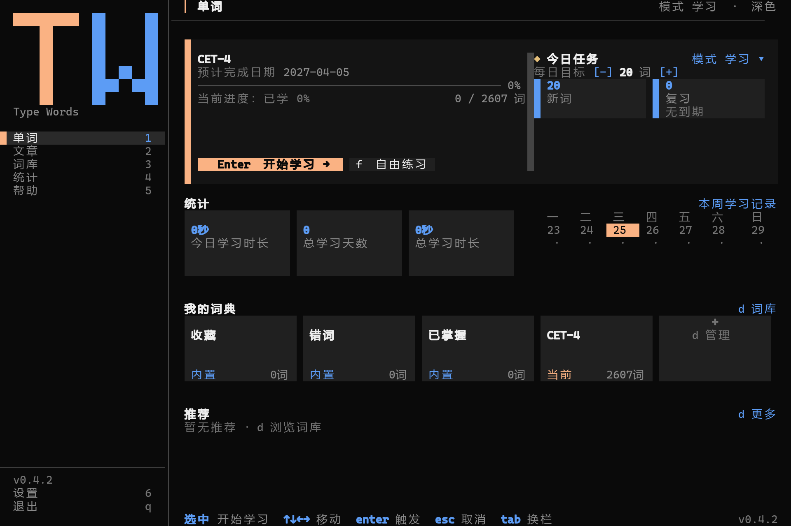
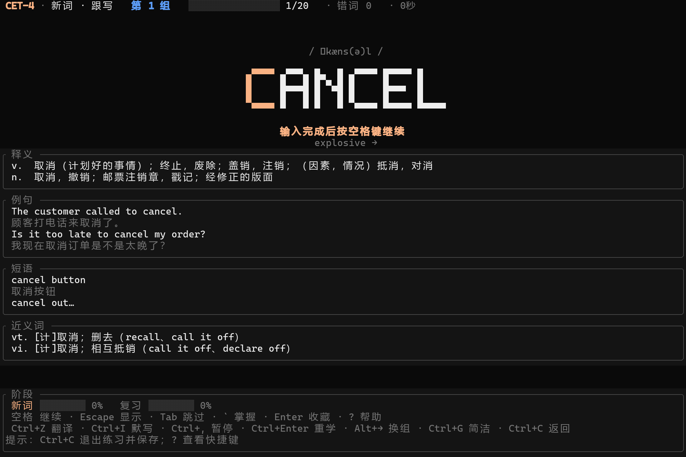

# TypeWords TUI —— 终端单词练习客户端

用 Rust + [ratatui](https://ratatui.rs/) 实现的 TypeWords 终端客户端：在终端里完成「选词库 → 学习 / 复习 → 结算 → 统计」闭环，进度保存在本地 JSON，重启进程可继续上次练习。

这是从 [TypeWords](https://github.com/zyronon/TypeWords) 拆分出来的独立项目，只包含终端客户端（Rust），不包含 Web / Tauri 桌面端。它与上游共享词库资源格式和存档字段命名，但**不共享代码**，也**不读写浏览器的 IndexedDB**；运行时不需要 Node.js 或 WebView。默认离线，唯一例外是设置里主动切到「有道发音」后下载 mp3。

## 功能概览

- **10 种练习模式**：学习、自由练习、自测、默写、听写、随机复习、复习、随机单词测试、单词测试、自定义流程；其中 7 个模式有内置流程。
- **单词练习主线**：跟写（7 词一组，组内拼写巩固）、听写、默写、自测；阶段间自动处理错词巩固，支持跳组、上一组 / 下一组、重学本组、默写本组。
- **FSRS 调度**：与上游 ts-fsrs 5.4.1 逐条对齐（公式、学习步进、fuzz 区间与随机源），同一张卡在两端得到相同的下次复习时间，黄金样本测试锁定；设置页「高级 FSRS」子屏可直接改目标留存率、最大间隔、fuzz、短期调度与 21 个权重，不必手改 `setting.json`。
- **单词测试**：4 选 1 答题，答错自动进入错词本；「随机单词测试」直接从整本词典抽题。
- **文章背诵**：内置《新概念英语1》，整篇同页展示、逐句跟打并对照中文译文；标点不用输入、词间空格可省，错误标在原位，支持断点续学。
- **自定义练习流程**：基于内置流程新建副本，编辑步骤顺序、乱序与组内巩固；启用后把练习模式切到「自定义流程」即按新编排练习。
- **词条与词典管理**：搜索、编辑、增删、排序、批量标记，可新建 / 复制自定义词典；三本内置词典（收藏 / 错词 / 已掌握）可设为当前学习词典或打开词条页，已掌握词在后续练习中自动排除。
- **可配置快捷键**：42 个动作可在设置页改绑，存于 `shortcutKeyMap`，与上游同构。
- **音频**：键音与对错提示音用终端响铃；单词发音、文章朗读用系统 TTS（Windows / macOS / Linux），可选切换到有道发音。
- **主题**：6 套内置（深色 / 浅色 / 高对比 / 午夜墨 / 纸墨 / 克莱因蓝）+ `<home>/themes/*.json` 自定义主题。
- **终端交互**：响应式外壳（宽屏侧栏 / 窄屏顶栏）、可点击的导航 / 按钮 / 列表、滚轮滚动；60 × 20 起可用。
- **断点续练**：单词游标与文章句进度写入本地 JSON，重启后按 `Enter` 继续；退出练习页回主页再按 `Enter` 也接着练。
- **工具命令**：`tw doctor` / `tw task` / `tw import-dict` / `tw export-dict` / `tw import-web` / `tw export-web`，覆盖排障、脚本化预览、词库导入导出与网页版备份互通。

非目标：Supabase 云同步、在线查词 / 翻译、多语言界面、xlsx 与 ZIP / mp3 打包备份、跨设备冲突合并。完整差异见 [与上游对照](docs/upstream-parity.md)。

## 快速开始

### 下载发布包（推荐）

从 [Releases](https://github.com/StarTurambar/typewords-tui/releases) 下载对应平台的 `typewords-tui-vX.Y.Z-<target>.tar.gz`，解压后得到一个同名顶层目录，内含可执行文件（Windows 为 `tw.exe`，Linux / macOS 为 `tw`）、`assets/`（词库与文章资源，必须与可执行文件同级）、`docs/`、`README.md` 与 `LICENSE`。

| 平台 | 归档名 | 解压后可执行文件 |
| --- | --- | --- |
| Windows x86_64（Windows 10+，系统自带 tar 可解压） | `typewords-tui-vX.Y.Z-x86_64-pc-windows-msvc.tar.gz` | `tw.exe` |
| Linux x86_64（glibc，在 Ubuntu 22.04 上构建） | `typewords-tui-vX.Y.Z-x86_64-unknown-linux-gnu.tar.gz` | `tw` |
| Linux x86_64（musl 静态，不依赖系统 glibc，任意发行版 / 容器可用） | `typewords-tui-vX.Y.Z-x86_64-unknown-linux-musl.tar.gz` | `tw` |
| macOS Apple Silicon（macOS 11+） | `typewords-tui-vX.Y.Z-aarch64-apple-darwin.tar.gz` | `tw` |
| macOS Intel（macOS 11+） | `typewords-tui-vX.Y.Z-x86_64-apple-darwin.tar.gz` | `tw` |

每个归档旁都有同名 `.sha256` 校验文件（内容为 `<sha256>  <归档名>`），Release 另附聚合文件 `SHA256SUMS`，一次列出全部归档。下载后先校验、再解压运行，归档与校验文件需放在同一目录：Linux / macOS 用 `sha256sum -c` / `shasum -a 256 -c` 读取 `.sha256` 里的归档名自行比对；Windows 用 `Get-FileHash` 的输出与 `.sha256` 里的值对照（输出为大写，比较时忽略大小写）。

Windows（PowerShell）：

    Get-FileHash .\typewords-tui-vX.Y.Z-x86_64-pc-windows-msvc.tar.gz -Algorithm SHA256
    tar -xzf typewords-tui-vX.Y.Z-x86_64-pc-windows-msvc.tar.gz
    .\typewords-tui-vX.Y.Z-x86_64-pc-windows-msvc\tw.exe doctor

Linux：

    sha256sum -c typewords-tui-vX.Y.Z-x86_64-unknown-linux-gnu.tar.gz.sha256
    tar -xzf typewords-tui-vX.Y.Z-x86_64-unknown-linux-gnu.tar.gz
    ./typewords-tui-vX.Y.Z-x86_64-unknown-linux-gnu/tw doctor

macOS：

    shasum -a 256 -c typewords-tui-vX.Y.Z-x86_64-apple-darwin.tar.gz.sha256
    tar -xzf typewords-tui-vX.Y.Z-x86_64-apple-darwin.tar.gz
    ./typewords-tui-vX.Y.Z-x86_64-apple-darwin/tw doctor

musl 静态包把归档名换成 `typewords-tui-vX.Y.Z-x86_64-unknown-linux-musl.tar.gz`，校验与解压命令相同。建议先运行 `doctor` 确认路径与词库，再进入界面。

### 从源码构建

需要 Rust **1.90+**（stable）。仓库自带 `assets/`，开发运行无需额外准备：

    git clone https://github.com/StarTurambar/typewords-tui.git
    cd typewords-tui
    cargo run --locked                  # 开发运行
    cargo build --release --locked      # 产物：target/release/tw（Windows 为 tw.exe）

### 第一次运行

    tw doctor   # 检查路径、词库、存档与主题
    tw          # 进入界面：Enter 开始学习，f 自由练习，? 查看帮助
    tw task     # 只预览今日任务，不进入界面

Windows 推荐 **Windows Terminal**，macOS / Linux 用任意支持真彩色的终端；最小尺寸 60 × 20；深色 / 浅色主题需要真彩色终端（不支持时可换「高对比」主题）。终端兼容性、组合键问题与鼠标说明见 [使用手册](docs/usage.md)。

## 常用命令

| 命令 | 说明 |
| --- | --- |
| `tw` | 启动界面 |
| `tw doctor` | 打印数据目录、资源目录、词库、5 份存档与主题状态；只读 |
| `tw task` | 预览今日任务（新词 / 到期复习 / 随机补足） |
| `tw import-dict FILE` | 把词条数组 JSON 导入数据目录并登记 |
| `tw export-dict [DICT_ID] [--out FILE]` | 把词库词条导出成可再导入的词条数组 JSON |
| `tw import-web FILE` | 导入网页版导出的备份 JSON（BackupData v5） |
| `tw export-web [--out FILE]` | 导出成网页版能导入的备份 JSON |
| `tw --assets DIR` | 指定只读资源目录（需含 `list/word.json`） |
| `tw --home DIR` | 指定数据目录（等价 `TYPEWORDS_HOME`） |
| `tw --dict ID` | 启动后直接进入指定词库；内置词典用 `wordCollect` / `wordWrong` / `wordKnown` |
| `tw --mode MODE` | 覆盖练习模式：`system/free/review/shuffle/identify/dictation/listen` |
| `tw --theme NAME` | 覆盖主题：`dark/light/high-contrast/midnight/paper/ikb/auto` 或自定义文件名 |
| `tw --seed N` | 固定随机种子（复现问题用） |
| `tw --reset-practice` | 启动前清空单词 / 文章断点缓存 |

以上参数都是全局参数，放在子命令前后均可（`tw task --seed 42` 与 `tw --seed 42 task` 等价）。完整参数、目录查找顺序与示例见 [使用手册 · 命令行参考](docs/usage.md#命令行参考)。

## 界面与操作速查

13 个页面：主页、练习、单词测试、词条管理、文章、文章跟打、流程、词库、统计、设置、快捷键、高级 FSRS、帮助（内含快捷键 / 常见问题 / 关于与反馈三个分页）；另有结算 / 输入 / 确认 / 模式 / 跳组 / 收藏目标 / 词条编辑 7 种弹层。宽屏（≥ 100 列）用左侧栏导航，窄屏用顶栏标签；数字 `1`~`6` 可直接切页（练习中与弹层打开时除外）。

| 场景 | 按键 |
| --- | --- |
| 主页 | `Enter` 开始 / 继续学习、`f` 自由练习、`d` 词库、`s` 设置、`t` 统计、`m` 选择练习模式、`a` 文章、`Ctrl+F` 练习流程、`+`/`-` 每日词数 ±5、`?` 帮助、`q` 退出（需确认） |
| 所有标签页 | `↑`/`↓`（`j`/`k`）在当前栏移动；`←`/`→` 执行页面横向操作（统计页四个方向键都在日历里按格子选日期，左边缘再 `←` 回页面签）；宽屏内容区左边缘再 `←` 进侧栏；`Tab`/`Shift+Tab` 换栏；进入页面默认选中内容区；`Enter` 触发、`Esc` 返回；到边停、不回绕 |
| 练习页 | 字母 / 空格 / 退格输入；`空格` 确认 / 继续；`Esc` 显示完整单词；`Tab` 跳过当前词；`Enter` 收藏；反引号标记已掌握；`Ctrl+Z` 翻译、`Ctrl+I` 默写遮罩、`Ctrl+,` 暂停计时、`Ctrl+P` 朗读、`Ctrl+L` 词表、`Ctrl+E` 例句 / 词源、`Ctrl+Enter` 重学本组、`Alt+←`/`Alt+→` 上下组、`Ctrl+C` 保存并返回；自测用 `1`/`2`/`3`，选择题用 `Alt+1`~`Alt+4` |
| 弹层 | 确认：方向键 / `Tab` 选按钮后 `Enter` / 空格执行，`y` 确认、`n`/`Esc` 取消；结算：方向键选按钮后 `Enter` / 空格执行，`r` / `q` 是固定快捷键；输入：`Enter` 保存、`Esc` 取消 |

- **帮助**：主页与两个练习页按 `?` 打开，`←` / `→` 在快捷键 / 常见问题 / 关于与反馈之间切换；关于页显示当前数据目录，反馈页列出提 issue 要附的诊断信息。
- **鼠标**：侧栏、按钮、列表、弹层、帮助分页可点击，滚轮滚动；程序开启鼠标捕获，按住 **Shift 拖拽**可选择文本。
- **主题**：设置页切换，或启动时 `--theme`；自定义主题放到 `<home>/themes/*.json`，格式见 [主题系统](docs/themes.md)。

完整按键表见 [快捷键](docs/shortcuts.md)；各页面布局与鼠标细节见 [使用手册 · 界面导览](docs/usage.md#界面导览)。

## 数据位置

默认数据目录：Windows 为 `%LOCALAPPDATA%\typewords-tui`，其他平台由 `dirs` 决定；可用 `--home` 或 `TYPEWORDS_HOME` 覆盖。

    <home>/
      dict.json              # 词典 + FSRS 卡片 + 收藏/错词/已掌握 + 统计（v4）
      setting.json           # 设置（v23）
      practice-word.json     # 单词断点缓存（v2）
      practice-article.json  # 文章跟打断点缓存（v1）
      flows.json             # 自建练习流程（无版本号）
      themes/*.json          # 自定义主题（启动时加载）
      dicts/、list/          # 通过 import-dict 导入的词库
      .tw.lock               # 数据目录独占锁（写入口常驻）
      logs/                  # 运行日志 tw-<日期>.log 与崩溃报告 crash-<时间戳>.txt（不属于存档）

写入采用唯一临时文件（`.<文件名>.tw-<pid>-<n>.tmp`）+ fsync + rename；同一数据目录同时只允许一个写实例。运行日志默认开启并写在 `<home>/logs/`（`--log` / `--no-log` / `--log-level` 可调），panic 时同目录还会生成 `crash-<时间戳>.txt`，报 issue 时附上即可。解析失败的存档会隔离为 `*.corrupt-<时间戳>.json`；版本高于程序支持的 `dict.json` 与 `setting.json` 只读不覆盖。备份、迁移与字段含义见 [存档与数据格式](docs/persistence.md)。

## 版本与变更日志

版本号遵循[语义化版本 2.0.0](https://semver.org/lang/zh-CN/)，每个版本的新增、变更与修复见 [CHANGELOG.md](CHANGELOG.md)（格式参照 Keep a Changelog）；GitHub Release 的发布说明由这份文件生成。升级时替换可执行文件与 `assets/` 即可，数据目录保持原位——存档版本有变化的版本会在条目里写明兼容性。

## 文档

完整文档在 [docs/](docs/README.md)：

| 文档 | 内容 |
| --- | --- |
| [使用手册](docs/usage.md) | 安装、终端要求、CLI、界面导览、10 种模式、按键、鼠标、FAQ 与排障 |
| [设置项参考](docs/settings.md) | 设置页 33 行的默认值、取值范围、作用；高级 FSRS 参数与无 UI 的透传字段 |
| [快捷键](docs/shortcuts.md) | 42 个动作、默认绑定、改绑、TUI 专有键、与上游差异 |
| [主题系统](docs/themes.md) | 13 个颜色 token、6 套内置主题、自定义主题格式与校验规则 |
| [存档与数据格式](docs/persistence.md) | 数据目录、5 份存档与资源 JSON、版本策略、与 Web 数据互通 |
| [总体架构](docs/architecture.md) | 分层与依赖约束、生命周期、状态 / 输入、子系统契约、扩展指南、技术债 |
| [开发指南](docs/development.md) | 构建 / 测试 / 静态检查、测试体系、调试、截图、词库同步、CI 与发布 |
| [与上游对照](docs/upstream-parity.md) | 与 Web / 桌面端的功能矩阵、行为差异、数据互通、同步方法 |

## 与上游 TypeWords 的关系

- 上游项目 [zyronon/TypeWords](https://github.com/zyronon/TypeWords) 是 Nuxt + Vue 的 Web / Tauri 桌面端；本仓库是**独立进程的终端客户端**，与上游共享词库资源格式和存档字段命名，但不共享代码，也不读写浏览器 IndexedDB。
- `assets/` 的词库与文章来自上游 `public/`，维护者可用 `node scripts/sync-assets.mjs --source <TypeWords 仓库路径>` 更新。
- 当前功能覆盖范围与差异见 **[与上游对照](docs/upstream-parity.md)**。

## 开发与贡献

提交前跑 `cargo fmt --all --check`、`cargo clippy --all-targets --locked -- -D warnings`、`cargo test --locked`（CI 同样覆盖 fmt / clippy / Ubuntu + Windows；发布 workflow 会在 tag 提交上先重跑同一套，全绿才打包发布）。测试体系、截图工具、词库同步与发布检查清单见 [开发指南](docs/development.md)；参与开发前也请读 [贡献指南](CONTRIBUTING.md)，文档纠错可直接提 PR。

本项目遵循 [GPL-3.0](LICENSE)。词库数据来自上游 TypeWords 仓库，遵循同一许可证。
