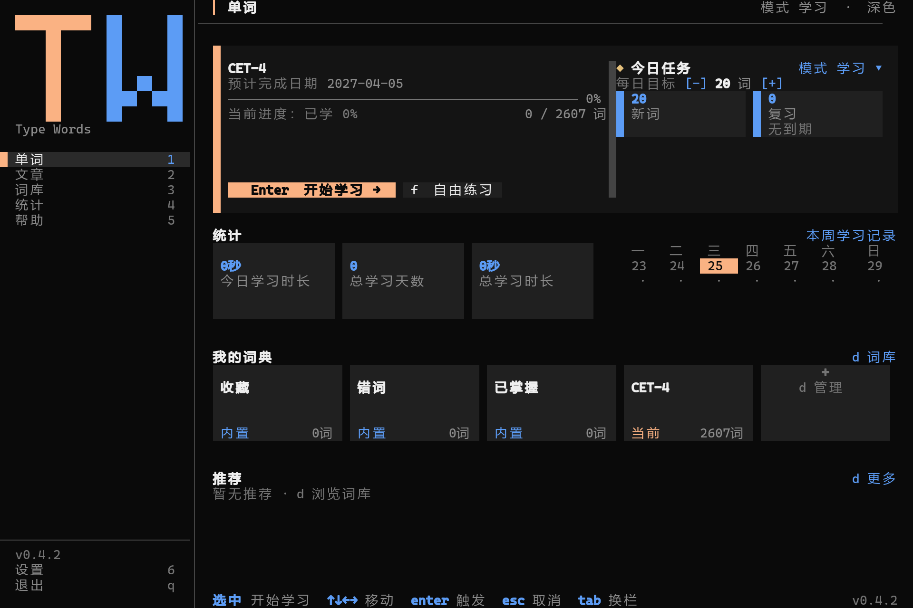
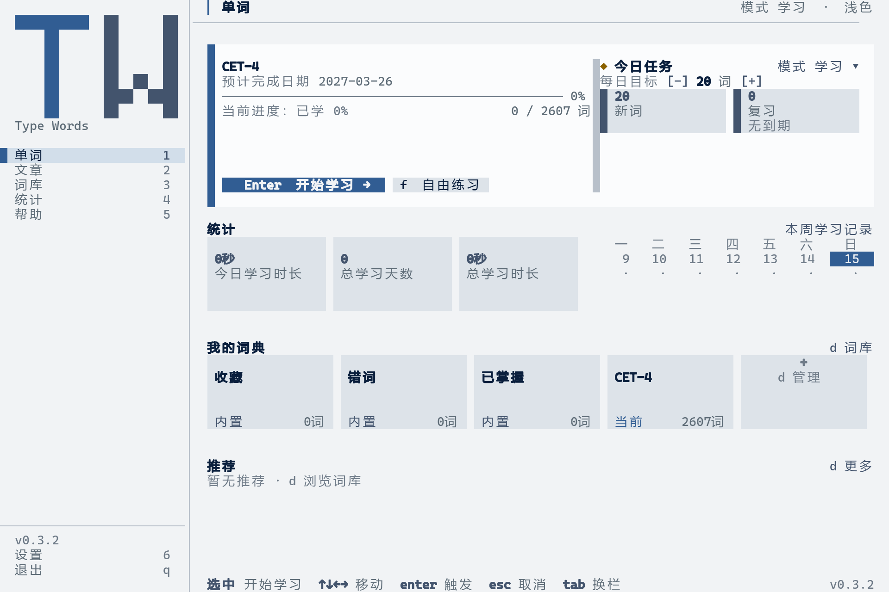
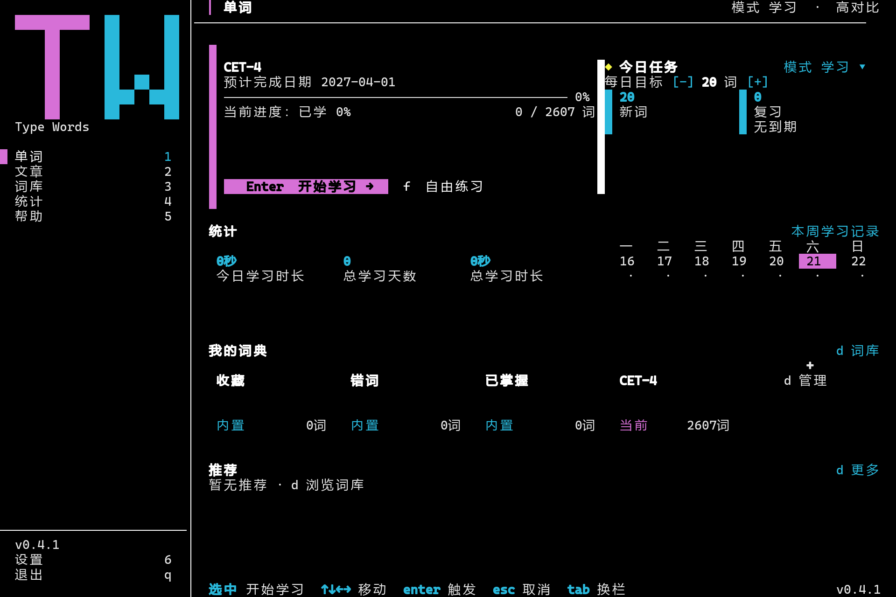
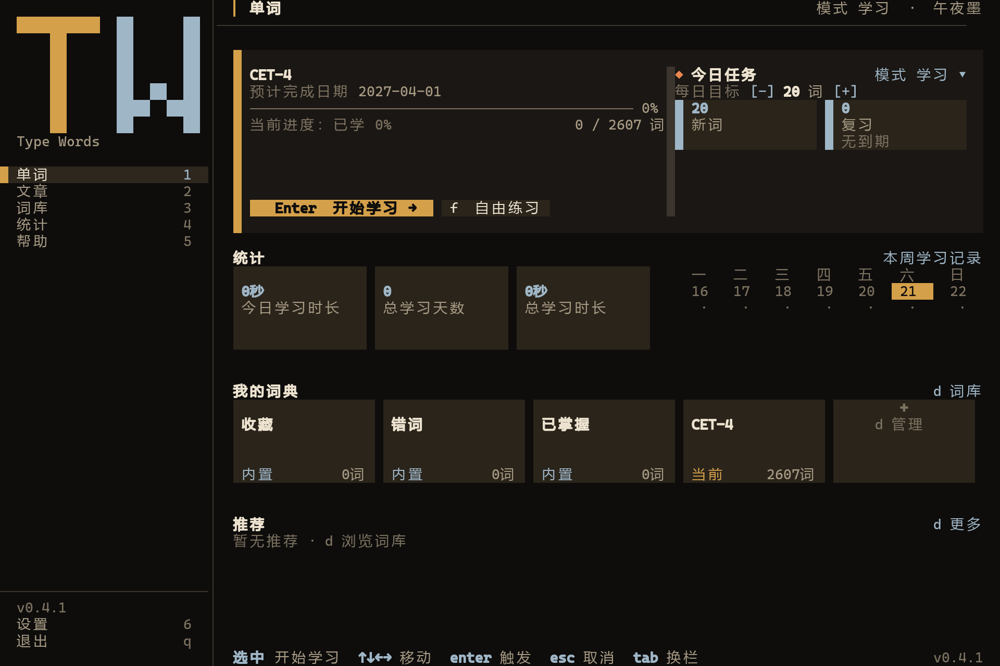
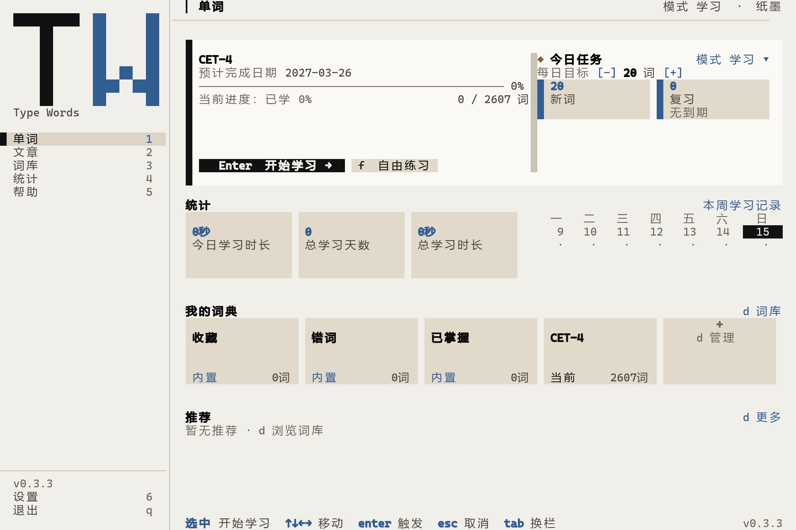
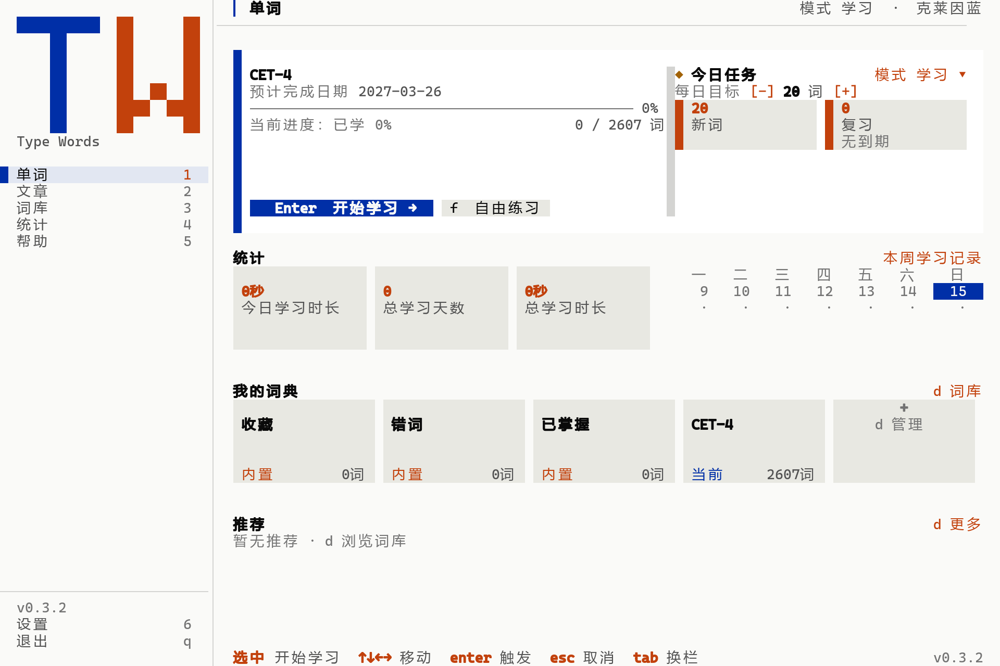

# 主题系统

typewords-tui 的配色全部来自主题：渲染层不出现硬编码颜色，所有前景 / 背景都从主题的 13 个颜色 token 取值。程序内置 6 套主题，也支持用户把 `*.json` 放进数据目录的 `themes/` 自定义。本文说明主题模型、内置主题、选择与优先级、自定义格式、颜色语法、token 语义与校验规则。

主题的配置层在 `src/theme/`，渲染映射在 `src/ui/theme.rs`；用户可见的切换入口见 [使用手册 · 设置与主题](usage.md#设置与主题)，设置项含义见 [设置项参考](settings.md)。

## 1. 主题模型与分层

一个主题由 `ThemeSpec` 描述：

| 组成 | 说明 |
| --- | --- |
| `id` | 主题标识：内置主题为 `dark` / `light` / `high-contrast` / `midnight` / `paper` / `ikb`；自定义主题为文件名转小写 |
| `name` | 显示名；为空时回退 id |
| `base` | 基础模式 `BaseMode`：`Dark` / `Light` / `HighContrast`，决定未覆盖 token 的继承来源 |
| `colors` | 13 个颜色 token（见第 6 节） |

主题代码分两层，互不依赖：

- `src/theme/`（配置层）：只回答「主题是什么」——`ThemeColor`（RGB 或 ANSI）、`ThemeSpec`、`ThemeRegistry`、内置主题表、用户主题加载与校验。它**不依赖 ratatui**，可单独测试。
- `src/ui/theme.rs`（渲染层）：把 `ThemeSpec` 的 13 个 token 转成 ratatui 的 `Color`（`ui::Theme`），供页面绘制。

### auto 的语义

设置里的 `theme` 默认值是 `auto`。`auto` 不做终端背景检测，**始终解析为深色（`dark`）**；它只是「跟随程序默认」的标记，设置页显示为「自动（深色）」。`--theme auto` 与不传 `--theme` 的默认效果相同。

## 2. 内置主题

| id | 名称 | 风格 | 适用场景 |
| --- | --- | --- | --- |
| `dark` | 深色 | 曜石：opencode 式中性近黑 + 暖橙强调 | 默认主题；深色终端、夜间使用 |
| `light` | 浅色 | 靛蓝瓷：归藏瓷白纸 + 单一靛蓝强调 | 默认浅色；浅色终端、明亮环境 |
| `high-contrast` | 高对比 | 纯黑底 + 纯白文字 + ANSI 亮色强调 | 不支持真彩色、需要最大对比度的场景 |
| `midnight` | 午夜墨 | 归藏 midnight-ink：暖黑纸 + 古金强调 | 深色可选预设；喜欢暖黑 / 杂志感 |
| `paper` | 纸墨 | 归藏 ink-classic：宣纸 + 墨色强调 | 浅色可选预设；阅读感（练习页「待输入字母」区分度较弱） |
| `ikb` | 克莱因蓝 | 归藏瑞士风：纸白 + 克莱因蓝 + 安全橙 | 浅色可选预设；高对比、强个性 |

内置色板（`src/theme/builtin.rs` 的 `builtin_specs`）：

| token | dark | light | high-contrast | midnight | paper | ikb |
| --- | --- | --- | --- | --- | --- | --- |
| `bg` | #0a0a0a | #f1f3f5 | black | #0e0d0c | #f1efea | #fafaf8 |
| `panel` | #141414 | #fbfcfd | black | #1a1714 | #fbf9f5 | #ffffff |
| `element` | #202020 | #dde3e9 | black | #2a241b | #e1dacb | #e8e8e2 |
| `border` | #444444 | #b8c0ca | white | #3b352d | #c9c3b5 | #d4d4d2 |
| `fg` | #eeeeee | #0a1f3d | white | #ece2cf | #0a0a0b | #0a0a0a |
| `muted` | #8a8a8a | #5f6d78 | gray | #a89b84 | #4a463f | #525252 |
| `dim` | #757575 | #6f7b88 | gray | #7d7260 | #6d675d | #737373 |
| `accent` | #fab283 | #315d93 | lightmagenta | #d4a04a | #111111 | #002fa7 |
| `accent_alt` | #5c9cf5 | #43546d | lightcyan | #9fb6c6 | #315d93 | #c2410c |
| `warn` | #e5c07b | #8a6100 | lightyellow | #e8874f | #9b5a2e | #a16207 |
| `good` | #7fd88f | #2e6b4f | lightgreen | #88c6a6 | #2e6b4f | #0f7a4a |
| `bad` | #e06c75 | #a63a43 | lightred | #d97a72 | #a63a43 | #b91c1c |
| `selection` | #2a2a2a | #d2deea | black | #2d271e | #dcd5c5 | #e2e7f2 |

## 3. 选择与优先级

- **设置页**：主题行循环切换，顺序是 `auto` → `dark` → `light` → `high-contrast` → `midnight` → `paper` → `ikb` → 自定义主题（按文件名排序）。
- **启动参数**：`--theme NAME` 在 `App::bootstrap` 覆盖 `settings.theme`；正常退出时随设置写回，等价于修改了设置。
- **解析**：`ThemeRegistry::resolve` 先 trim 再转小写；`""` / `auto` → `dark`；命中返回主题；未命中回退 `dark` 并返回回退标志，界面弹 Warning。
- **循环的已知行为**：设置页循环用**精确字符串**查找当前位置，找不到时从下标 0（`auto`）开始；因此 `--theme LIGHT` 或拼错的名字在设置页按 `Enter` 会先跳到 `dark`。用设置页重新选一次，或把 `setting.json` 的 `theme` 改成小写 id 即可。
- **加载时机**：自定义主题只在启动装载时从 `<home>/themes/` 读取；运行中新增或修改 `*.json` 需要重启进程。

## 4. 自定义主题

### 目录与文件名

把 `*.json` 放进 `<home>/themes/`（数据目录见 [存档与数据格式](persistence.md)），启动时加载。文件名规则：

- 取文件名去掉 `.json` 作为 id，转小写；长度 1~32，只能包含 ASCII 字母、数字、下划线与连字符。
- `auto` 与 6 个内置 id 是保留名；同名文件会被跳过并告警「主题 X.json 与内置主题重名，已跳过」。
- 显示名取 `name`（trim 后非空），否则回退文件名原文。

### JSON 结构

    {
      "name": "Ocean",
      "base": "dark",
      "colors": {
        "bg": "#0b1020",
        "panel": "#111a33",
        "accent": "#6fd3c7",
        "accent_alt": "#8ab4ff"
      }
    }

- 三个字段都可省略：缺省 `name` 用文件名，缺省 `base` 用 `dark`，缺省 token 从 base 主题继承。
- `base` 接受 `dark` / `default` / `light` / `high-contrast` / `high_contrast` / `contrast`；其它值报错并跳过该文件。
- `colors` 下只接受 13 个 token 名；出现未知字段（`deny_unknown_fields`）或颜色解析失败时，整个文件被跳过并记一条告警，不影响启动。
- 颜色值支持 `#rgb` / `#rrggbb` 与 ANSI 颜色名，可混用。

### 校验失败的行为

加载失败只跳过该文件，程序继续用内置主题运行；`tw doctor` 会打印自定义主题数量、主题目录、全部主题 id / 名称与加载告警。常见原因：JSON 语法错误、未知字段、非法 token、颜色写法错误、id 是保留名、文件名含非法字符。

### 一个简短变体

    {
      "name": "Paper Blue",
      "base": "light",
      "colors": { "accent": "#1f4e8c", "accent_alt": "#c2410c" }
    }

## 5. 颜色语法

### RGB 十六进制

`#rgb`（每位重复一次，如 `#0af` → `#00aaff`）或 `#rrggbb`，大小写不敏感。

### ANSI 颜色名

内置高对比主题用 ANSI 名，映射到终端自身的 16 色板。支持 `black` / `red` / `green` / `yellow` / `blue` / `magenta` / `cyan` / `gray` / `white`，以及 `lightred` / `lightgreen` / `lightyellow` / `lightblue` / `lightmagenta` / `lightcyan` 等亮色变体（大小写与常见别名如 `darkgray` 会被归一化）。具体可用名以 `src/theme/mod.rs` 的 `ThemeColor::parse` 为准；写错会跳过整个主题文件。

### 为什么高对比主题用 ANSI

RGB 需要终端支持 24-bit 真彩色；不支持时会被量化甚至失真。ANSI 颜色名映射到终端自己的色板，任何终端都能显示，并跟随用户的终端配色，可读性更稳。

## 6. 13 个颜色 token 语义

| token | 语义 | 典型用途 |
| --- | --- | --- |
| `bg` | 页面背景 | 全屏底色、弹层外遮罩恢复 |
| `panel` | 面板背景 | 卡片、弹层、侧栏块面 |
| `element` | 次级块面 | 数字卡、次级按钮、窄屏当前页标签 |
| `border` | 边框与分隔线 | 信息卡边框、设置分区横线 |
| `fg` | 正文与标题主色 | 标题加粗、普通文本 |
| `muted` | 次要文字 | 未选中导航、副标题、说明文字 |
| `dim` | 提示 / 弱化信息 | 版本号、底部快捷键提示、遮罩空心方框 |
| `accent` | 主强调色 | 当前页左条、顶栏 `▎`、主按钮背景、选中行左条、键盘焦点整块底色（反色文字） |
| `accent_alt` | 次强调色 | 数字与数值、进度条、设置值、滚动指示、Info Toast |
| `warn` | 警告 | 警告 Toast、计时暂停、今日任务标记 |
| `good` | 正确 / 成功 | 正确字母、成功 Toast、开启状态 |
| `bad` | 错误 / 危险 | 错误字母、错词数、错误 Toast |
| `selection` | 选中行背景 | 侧栏当前项、列表选中行、统计页今日条、帮助页当前分页（焦点在导航栏时） |

配色建议：保证 `fg` / `bg` 对比度足够（正文建议 ≥ 4.5:1）；`selection` 要能与 `panel` / `element` 区分；`good` / `warn` / `bad` 保持语义稳定，不要互换。

## 7. 内部实现

    builtin_specs()（6 套内置）
   + ThemeRegistry::load(<home>/themes)（用户 *.json，失败只告警）
             ↓
        ThemeRegistry（BTreeMap + 有序 order + warnings）
             ↓  resolve(settings.theme)   // 每帧由 App::theme() 调用
        ThemeSpec（id、name、base、13 token）
             ↓  ui::Theme::from_spec（src/ui/theme.rs）
        ratatui Color（各页面绘制）

- 内置主题先按 `dark / light / high-contrast / midnight / paper / ikb` 入表，自定义主题按文件名排序追加；`DEFAULT_THEME_ID = "dark"`。
- `resolve("")` 与 `resolve("auto")` 返回 dark 且不标记回退；未知 id 返回 `(dark, true)`。
- `cycle_ids()` 返回 `["auto"] + 全部主题 id`；设置页循环与自定义主题排序都基于它。
- 每帧解析一次 `ThemeSpec` 再构造 13 色的 `ui::Theme`，开销可忽略；渲染层不得缓存或硬编码颜色。

## 8. 常见问题

| 现象 | 原因 | 处理 |
| --- | --- | --- |
| 自定义主题没生效 | 文件不在 `<home>/themes/`、扩展名不是 `.json`，或修改后没重启 | 放到主题目录并重启；用 `tw doctor` 看主题清单与告警 |
| 启动有主题告警 | 文件名 / id、JSON 字段、颜色写法不合规，或与内置主题重名 | 按告警修文件；改完重启 |
| 颜色发灰、偏色、出现怪色 | 深色 / 浅色主题使用 24-bit RGB，终端不支持真彩色时会近似 | 确认 `COLORTERM=truecolor`，或换「高对比」/自定义 ANSI 主题 |
| `--theme LIGHT` 后设置页第一次按 `Enter` 跳到深色 | 循环用精确字符串匹配 | 用设置页重新选，或把 `setting.json` 的 `theme` 改成小写 id |
| 想基于现有主题改几个色 | 全部 13 个 token 的色板都在本文第 2 节 | 复制色值到 `colors`，只覆盖需要改的 token |

## 相关文档

- [使用手册 · 设置与主题](usage.md#设置与主题)
- [设置项参考](settings.md)
- [总体架构](architecture.md)
- [存档与数据格式](persistence.md)
