# 使用手册

typewords-tui 是 TypeWords 的终端客户端：在终端里选词库、按 FSRS 排程练习单词、结算并查看统计，进度保存在本地 JSON。本文是面向使用者的完整手册，从安装讲到排障；项目定位与功能全景见 [根 README](../README.md)。界面与文案为简体中文，操作以键盘为主、鼠标为辅；设置项逐项解释见 [设置项参考](settings.md)，配色与自定义主题见 [主题系统](themes.md)，数据文件格式见 [存档与数据格式](persistence.md)。

## 环境要求与终端兼容性

官方发布包覆盖 Windows x86_64（`x86_64-pc-windows-msvc`）、Linux x86_64（`x86_64-unknown-linux-gnu` 与静态链接的 `x86_64-unknown-linux-musl`）、macOS Apple Silicon（`aarch64-apple-darwin`）与 Intel（`x86_64-apple-darwin`），下载、解压与校验见下面「安装与升级 → 下载发布包」。源码同样可在这些平台构建（CI 覆盖 Ubuntu 与 Windows）：构建需 Rust 1.90+ stable（edition 2024），Windows 另需 MSVC 工具链；运行期不需要 Node.js / WebView，默认离线，唯一联网点是主动把「发音来源」切到「有道发音」后下载 mp3。

终端最小 60 × 20；主题按 24-bit RGB 输出（建议 `COLORTERM=truecolor`，低色彩终端用「高对比」）；字体需等宽且支持中文与制表符，Windows 推荐 Windows Terminal；鼠标需终端上报事件，不支持时仍可纯键盘操作。组合键在部分终端或输入法下会被吞掉：常见的是 `Alt+数字`、`Ctrl+方向键`、`Ctrl+Enter`，有的终端还把 `Ctrl+I` / `Ctrl+J` / `Ctrl+M` 与 Tab / 换行 / Enter 视为同一字节，替代方式见「按键参考」；程序正常退出会恢复终端，进程被强制结束时终端可能停在备用屏幕或鼠标捕获状态，重开一个终端即可。

## 安装与升级

### 下载发布包

从 [Releases](https://github.com/StarTurambar/typewords-tui/releases) 下载对应平台的归档与同名 `.sha256`：

| 平台 | 归档名 | 解压后可执行文件 |
| --- | --- | --- |
| Windows x86_64（Windows 10+，系统自带 tar 可解压） | `typewords-tui-vX.Y.Z-x86_64-pc-windows-msvc.tar.gz` | `tw.exe` |
| Linux x86_64（glibc，在 Ubuntu 22.04 上构建） | `typewords-tui-vX.Y.Z-x86_64-unknown-linux-gnu.tar.gz` | `tw` |
| Linux x86_64（musl 静态，不依赖系统 glibc，任意发行版 / 容器可用） | `typewords-tui-vX.Y.Z-x86_64-unknown-linux-musl.tar.gz` | `tw` |
| macOS Apple Silicon（macOS 11+） | `typewords-tui-vX.Y.Z-aarch64-apple-darwin.tar.gz` | `tw` |
| macOS Intel（macOS 11+） | `typewords-tui-vX.Y.Z-x86_64-apple-darwin.tar.gz` | `tw` |

解压后得到 `typewords-tui-vX.Y.Z-<target>/` 目录，内含可执行文件、`assets/`（只读资源：`list/word.json` 与 `dicts/`，内置 CET-4）、`docs/`、`README.md` 与 `LICENSE`；程序自动使用同级的 `assets/`（必须与可执行文件同级，否则用 `--assets` 指定）。每个归档旁的 `.sha256` 内容为 `<sha256>  <归档名>`，Release 另附聚合文件 `SHA256SUMS`（`sha256sum -c SHA256SUMS` 可一次校验全部归档）；Windows 把 `Get-FileHash` 的输出与 `.sha256` 里的值对照（输出为大写，比较时忽略大小写）。先校验哈希再运行：

Windows（PowerShell）：

```powershell
Get-FileHash .\typewords-tui-vX.Y.Z-x86_64-pc-windows-msvc.tar.gz -Algorithm SHA256
tar -xzf typewords-tui-vX.Y.Z-x86_64-pc-windows-msvc.tar.gz
.\typewords-tui-vX.Y.Z-x86_64-pc-windows-msvc\tw.exe doctor
```

Linux：

```bash
sha256sum -c typewords-tui-vX.Y.Z-x86_64-unknown-linux-gnu.tar.gz.sha256
tar -xzf typewords-tui-vX.Y.Z-x86_64-unknown-linux-gnu.tar.gz
./typewords-tui-vX.Y.Z-x86_64-unknown-linux-gnu/tw doctor
```

macOS：

```bash
shasum -a 256 -c typewords-tui-vX.Y.Z-x86_64-apple-darwin.tar.gz.sha256
tar -xzf typewords-tui-vX.Y.Z-x86_64-apple-darwin.tar.gz
./typewords-tui-vX.Y.Z-x86_64-apple-darwin/tw doctor
```

- **glibc 太旧**：`x86_64-unknown-linux-gnu` 在 Ubuntu 22.04 上构建（glibc 2.35 基线）；发行版比它更老（运行报 `GLIBC_2.3x not found`）或使用精简容器时，改用静态链接的 `x86_64-unknown-linux-musl` 包，把归档名换掉即可，校验与解压命令相同。
- **macOS Gatekeeper**：发布包未签名，从浏览器下载的二进制可能带隔离属性，首次运行提示「无法验证开发者」或「已损坏」时，先按上面的 `shasum` 校验哈希，再执行 `xattr -d com.apple.quarantine ./tw`。
- 解压后提示没有执行权限时执行 `chmod +x tw`。

### 从源码构建

```bash
git clone https://github.com/StarTurambar/typewords-tui.git && cd typewords-tui
cargo run --locked                    # 开发运行，自动使用仓库内 assets/
cargo build --release --locked        # 产物 target/release/tw（Windows 为 tw.exe）
pwsh -File scripts/package.ps1        # 本地打 Windows 发布包，产物在 dist/
bash scripts/package.sh               # Linux / macOS 本地打同结构的 tar.gz 包，产物在 dist/
```

`--locked` 按仓库提交的 `Cargo.lock` 锁定依赖；`pwsh -File scripts/package.ps1` 用于 Windows、`bash scripts/package.sh` 用于 Linux / macOS，两者都产出 `dist/<归档名>.tar.gz` 与同名 `.sha256`。直接运行 `target/release/tw`（Windows 为 `tw.exe`）时仍需把 `assets/` 放在可执行文件同级，或用 `--assets` / `TYPEWORDS_ASSETS` 指定。构建、测试与发布流程见 [开发指南](development.md)。

### 首次启动与数据目录

| 系统 | 默认数据目录 |
| --- | --- |
| Windows | `%LOCALAPPDATA%\typewords-tui` |
| Linux | `$XDG_DATA_HOME/typewords-tui`，缺省 `~/.local/share/typewords-tui` |
| macOS | `~/Library/Application Support/typewords-tui` |

首次运行自动创建目录并写入 5 份存档：`dict.json`（词典、学习进度、FSRS 卡片、三本系统词典与统计）、`setting.json`（设置）、`practice-word.json`（单词断点缓存）、`practice-article.json`（文章跟打断点）、`flows.json`（自建流程），另有 `themes/`、`dicts/`、`list/`，以及运行日志与崩溃报告的 `logs/`（不是存档，删了不影响学习进度）；字段与版本见 [存档与数据格式](persistence.md)。没有存档时使用默认设置并自动选择内置 CET-4，退出程序在主页按 `q` 并确认。写入口（TUI、`tw task`、`tw import-dict`、`tw import-web`）启动时对 `<home>/.tw.lock` 取排他锁：同一个数据目录同时只允许一个写实例，第二个实例直接报错退出，而不是两边互相覆盖存档；`tw doctor` / `tw export-dict` / `tw export-web` 只读，TUI 运行时也能用。

### 升级与版本兼容

升级 = 用新版本的发布包替换可执行文件（Windows 为 `tw.exe`，Linux / macOS 为 `tw`）与 `assets/`，保留数据目录；新增字段都带默认值，旧存档可读。版本高于程序支持的 `dict.json` / `setting.json` 本次运行只读、不覆盖原文件；练习缓存版本不符时忽略（不移动文件）。升级前建议备份数据目录，版本策略与迁移细节见 [存档与数据格式](persistence.md)。

## 命令行参考

### 参数

| 参数 | 含义 | 备注 |
| --- | --- | --- |
| `--assets DIR` / `--home DIR` | 只读资源目录（需含 `list/word.json`）/ 数据目录（存档、导入词库、主题） | 全局参数，可放在子命令前后；等价 `TYPEWORDS_ASSETS` / `TYPEWORDS_HOME` |
| `--dict ID` | 启动时切到指定词库（id 或 enName，如 `cet4`）；三本内置词典用 `wordCollect` / `wordWrong` / `wordKnown` | 写入当前学习词库（与词库页 `Enter` 同效）；找不到词库时报错退出 |
| `--mode MODE` | 覆盖练习模式：`system/free/review/shuffle/identify/dictation/listen` | 另接受 `smart` 与中文别名；单词测试与自定义流程只能在界面里用 `m` 选；退出时随设置保存 |
| `--theme NAME` | 覆盖主题：`dark` / `light` / `high-contrast` / `midnight` / `paper` / `ikb` / `auto` 或自定义文件名 | 未知名字回退深色并 Toast；退出时随设置保存 |
| `--seed N` / `--reset-practice` | 固定随机种子 / 启动前清空练习缓存 | 种子影响洗牌、选择题与随机复习（TUI 缺省随机，`tw task` 缺省 42）；清空删 `practice-word.json` 与 `practice-article.json`，不动词典与设置，仅 TUI 生效 |
| `--log FILE` | 运行日志文件 | 全局参数，可放在子命令前后；缺省 `<home>/logs/tw-<日期>.log`（目录不存在会创建）；与 `--no-log` 冲突；崩溃报告写到该文件所在目录 |
| `--no-log` | 关闭运行日志 | 全局参数；崩溃报告仍写入 `<home>/logs/`；与 `--log` 冲突 |
| `--log-level LEVEL` | 日志级别：`error` / `warn` / `info` / `debug` | 全局参数，缺省 `info`（`warning` 视同 `warn`，大小写不敏感）；排障时用 `debug` 能看到更多记录 |

`-h` / `--help` 与 `-V` / `--version` 由 clap 生成，后者输出版本号。

### 子命令

| 子命令 | 作用 | 输出要点 |
| --- | --- | --- |
| `tw doctor` | 打印解析到的路径与词库 / 存档 / 主题状态，不进入界面、不写存档 | 版本行、数据目录、资源目录、日志目录（`<home>/logs`，`--log` 可指定文件、`--no-log` 关闭）；每本词库的 id / enName / 名称 / 目录登记词数 / 实际可练习词数（空词条不计，与程序真正加载的词数一致）与词条文件路径（缺失显示 `<缺失>`，解析失败显示原因）；5 份存档的字节数或「不存在」；自定义主题数量、主题目录、全部主题 id 与名称、加载告警 |
| `tw task` | 只预览今日任务，不进入界面 | 当前词库与每日词数、学习进度（`已学 N / M` 与百分比同源，分母是有效词数）、今日任务（新词 / 复习，到期数与随机补足数）与前 5 个新词、复习词；需取数据目录锁 |
| `tw import-dict FILE` | 把词条数组 JSON 复制到 `<home>/dicts/en/word/` 并登记到 `<home>/list/word.json` | 打印词库名、词数与 `使用 tw --dict <id> 切换到该词库`；id 取文件名去掉 `.json` |
| `tw export-dict [DICT_ID] [--out FILE]` | 把词库词条导出成词条数组 JSON（`import-dict` 的逆操作），可直接再导入 | 缺省写到标准输出（只有 JSON，便于重定向）；`--out` 指定文件时打印词库名、词数与路径。`DICT_ID` 取 id 或 enName，缺省用全局 `--dict`，再缺省用当前学习词库；收藏 / 错词 / 已掌握的词条只在存档里，也能导出；只读，不取锁 |
| `tw import-web FILE` | 导入网页版导出的备份 JSON（`BackupData` v5） | 逐项打印已导入 / 已跳过 / 已拒绝 / 已丢弃 / 已备份；导入后需重启程序 |
| `tw export-web [--out FILE]` | 把当前数据目录导出成网页版能导入的备份 JSON | 缺省写到标准输出；`--out` 指定文件时打印路径；只读，不取锁 |

`import-dict` 要求文件以 `.json` 结尾、内容为词条数组（每项至少含 `word` 字段）、至少有一个可用单词；重复导入同一文件名会覆盖同 id 的登记项，不产生重复条目。`export-dict` 与它对称：输出同样是词条数组（`Word` 的全部字段，空词条被过滤），空词库直接报错而不是写出一个 `import-dict` 不接受的 `[]`；导出文件可原样再导入，`id` 取新文件名。`import-web` / `export-web` 与网页版「设置 → 数据管理 → 导出」同一套格式：备份版本高于 5 时拒绝导入；逐项校验存档版本，任一项版本过高或反序列化失败就跳过 / 拒绝该项，原文件保持不变；覆盖前先复制为 `<文件名>.bak-<时间戳>.json`，失败会回滚；文章练习缓存按来源分流（本程序导出的备份能还原句子进度，网页版自己产生的缓存只有「段落 / 句 / 词」游标，导入时列为「已丢弃」）。完整规则见 [存档与数据格式](persistence.md)。

### 环境变量与目录查找顺序

`TYPEWORDS_HOME` 是数据目录、优先级低于 `--home`；`TYPEWORDS_ASSETS` 是资源目录、优先级低于 `--assets`。资源目录取第一个包含 `list/word.json` 的目录：`--assets DIR` → `TYPEWORDS_ASSETS` → 可执行文件同级的 `assets/` → 当前目录及其向上最多 3 级祖先的 `assets/`（同一层级的 `public/` 也接受，便于从上游仓库内运行）；全部失败时启动报「找不到词库资源目录」。数据目录按 `--home` > `TYPEWORDS_HOME` > 系统本地数据目录查找，都没有时提示用 `--home` 指定。词库目录是 `<assets>/list/word.json` 与 `<home>/list/word.json` 的合并结果，同 id 时数据目录（用户导入）覆盖资源目录；词条文件同样先找 `<home>/dicts/…`，再找 `<assets>/dicts/…`。

### 常用示例

```bash
tw --dict cet4                       # 直接进入 CET-4；内置词典用 wordWrong / wordCollect / wordKnown
tw doctor --home D:\tmp\twhome       # 全局参数也可放在子命令之后
tw task --seed 42                    # 预览今日任务，固定随机种子
tw import-dict .\my-words.json        # 导入自定义词库，再用 tw --dict my-words 切换
tw export-dict --out .\backup.json   # 导出当前学习词库；tw export-dict cet4 导出到标准输出
```

## 日志与崩溃报告

运行日志默认开启，不需要任何参数；panic 时还会自动生成崩溃报告。两者的默认落点都是 `<home>/logs/`。

### 运行日志

| 项 | 说明 |
| --- | --- |
| 文件 | `<home>/logs/tw-<YYYY-MM-DD>.log`，日期取**启动当天**的本地日期（跨零点的长会话仍写同一个文件）；追加写，目录不存在会创建 |
| 行格式 | `YYYY-MM-DD HH:MM:SS.mmm LEVEL message`，级别为 `ERROR` / `WARN` / `INFO` / `DEBUG`（左对齐占 5 列）；每行单独打开追加写，进程崩溃前的最后几行也会留下 |
| 级别 | `--log-level error` / `warn` / `info` / `debug`，缺省 `info`（`warning` 视同 `warn`，大小写不敏感）；排障时可临时用 `debug` |
| 换位置 / 关闭 | `--log FILE` 指定日志文件（目录不存在会创建），`--no-log` 关闭运行日志，两者互斥 |
| 保留 | 启动时清理日志所在目录里的过期文件：日志保留 14 天、崩溃报告保留 30 天（按修改时间，只匹配 `tw-*.log` 与 `crash-*.txt`，其它文件不动） |

记录内容：版本头、平台、进程号、命令行、数据目录 / 资源目录 / 日志文件、数据目录锁获取、执行的子命令、存档装载状态与词库 / 主题数量、当前学习词典、界面 Toast 里的错误与警告（成功 / 提示类只有 `debug` 才记）、进入与退出 TUI、进程退出（正常 / 失败）与错误链。日志写失败（例如目录不可写）只在 stderr 打一条警告，程序照常运行；所有入口（包括只读的 `tw doctor` / `tw export-web`）都会追加日志，日志写入不取数据目录锁。

### 崩溃报告

- **位置与文件名**：与日志同目录——默认 `<home>/logs/`，用过 `--log` 就是该文件所在的目录（该目录不可创建时降级到系统临时目录的 `typewords-tui-crash/`）；文件名为 `crash-<YYYYMMDD-HHMMSS>.txt`，同一秒内多次崩溃追加 `-2`、`-3`，不覆盖旧报告。`--no-log` 只关运行日志，崩溃报告仍然生成。
- **内容**：生成时间、版本、进程号、平台、命令行、当前目录、可执行文件、数据目录、资源目录、日志文件（尚未解析到的显示「（未解析）」/「（未启用）」）、panic 消息与位置、完整回溯、最近 40 行日志，以及反馈提示。回溯用 `std::backtrace::force_capture` 捕获，**不需要**设置 `RUST_BACKTRACE`。
- **怎么用**：报告写好后路径会打印到 stderr（「程序崩溃，崩溃报告已写入: …」）；提 issue 时把这个 `.txt` 与同目录最近的 `tw-*.log` 一起附上，再写清复现步骤。报告写失败（目录不可写）只会再提示一次，不会递归写第二份。
- **覆盖范围**：只有 panic 会生成报告；启动期的致命错误（`Error: …`）写进日志与 stderr，不生成 `crash-*.txt`。

### Windows 双击启动的早退保护

从资源管理器双击 `tw.exe`（没有任何命令行参数，且 stdin 与 stderr 都是终端）时，早期错误或 panic 之后会显示「按回车键退出...」并等待回车，控制台窗口不会一闪而过：

- 加了参数启动（从 cmd / PowerShell、脚本、快捷方式带参数）不会等待。
- 设置 `TW_NO_PAUSE`（任意值，如 `TW_NO_PAUSE=1`）或在 `CI` 环境下运行会自动跳过等待，适合自动化。
- 早期错误的输出（stderr）是 `Error: <错误链>`、`日志文件: <路径>` 与反馈提示；`--no-log` 时改为提示 `运行日志未启用；可用 --log <FILE> 指定日志文件。`

## 界面导览

共 13 个页面：主页、练习、单词测试、词条管理、文章、文章跟打、流程、词库、统计、设置、高级 FSRS、快捷键、帮助；另有结算 / 输入 / 确认 / 模式 / 跳组 / 收藏目标 / 词条编辑 7 种弹层。除练习页与文章跟打页全屏外，其余页面共用一套外壳；高级 FSRS 与快捷键一样从设置页进入，侧栏高亮「设置」。截图默认 120 × 40 深色主题。

### 外壳

宽屏（≥ 100 列）左侧栏 24 列（≥ 120 列时 26 列）：`TW` 标识、单词 / 文章 / 词库 / 统计 / 帮助（数字键 1~5）、分隔线、版本号、设置（6）、退出（`q`）；窄屏（< 100 列）无侧栏，顶栏右侧是「单词 / 文章 / 词库 / 统计 / 帮助 / 设置」六个标签，当前页高亮。顶栏左侧是当前页标题（`▎` 前缀），右侧空间足够时显示「模式 X · 主题名」；底栏左侧是 Toast（约 3.2 秒消失、最多 4 条），无 Toast 时显示当前页快捷键。窗口小于 60 × 20 时只显示「终端太小，请放大窗口」，键盘与鼠标事件一律忽略（放大后恢复）。所有标签页共用两栏焦点模型：进入页面默认选中内容区（底栏显示「选中 X」；帮助页内容区没有选中项，底栏改为分页提示，进导航栏后恢复焦点提示），`↑` / `↓`（别名 `j` / `k`）在当前栏移动、`←` / `→` 执行页面横向操作（宽屏内容区左边缘再 `←` 进侧栏；统计页日历左边缘在窄屏也直接回顶栏）、`Tab` / `Shift+Tab` 换栏、`Enter` 触发选中项、`Esc` 在主页取消选中 / 其它页面返回；到边停、不回绕。选中项因窗口缩放失效时 `Enter` 只清空选中并提示，不会误开练习；点击导航栏或内容区会把键盘选中同步过去。

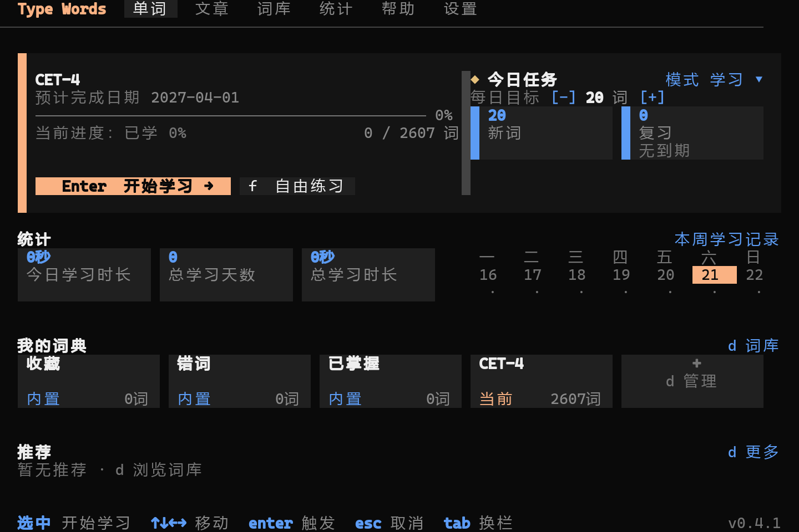 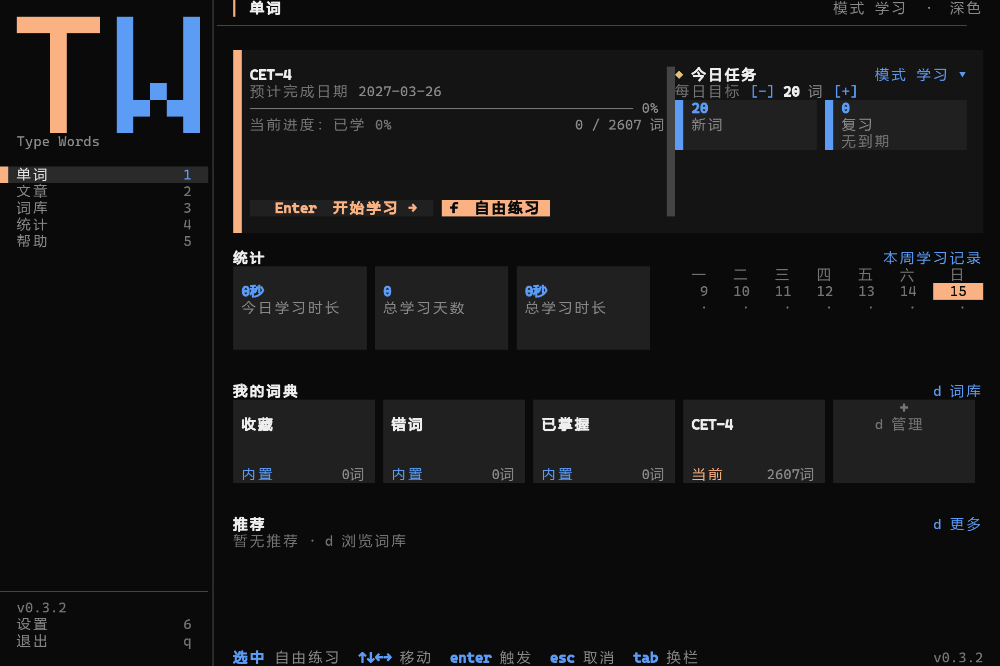 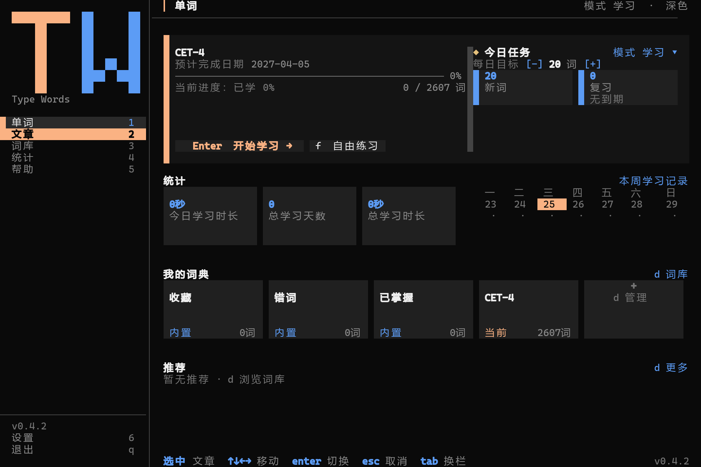

### 主页

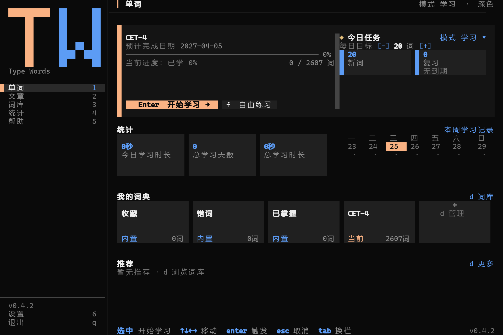

1. **当前词库卡片**：词库名、预计完成日期（已学完显示「已学完 · 总复习阶段」）、进度条与百分比、「已学 N / M 词」（百分比与词数同源，M 是有效词数），底部「Enter 开始 / 继续学习」与「f 自由练习」。
2. **今日任务与统计**：每日目标 `[-] N [+]`（每次 ±5，精确值在设置页输入）与「新词 / 复习」数字卡（无到期复习时显示「无到期」），标题右端「模式 X ▾」可点或按 `m` 切换练习模式；下方是今日学习时长 / 总学习天数 / 总学习时长、「本周学习记录」（周一至周日，今天高亮）、3~5 块词库卡（`内置` / `当前` / `词库` 徽标 + 词数）与未加入的词库推荐（标题右侧「d 更多」）。

内容区按视觉行分带，`↑` / `↓` 走上 / 下一带、`←` / `→` 在同带内左右移动，`Esc` 或点空白取消选中。有未完成的单词断点时，标题从「今日任务」变成「上次任务」、主按钮从「开始学习」变成「继续学习」，数字卡显示缓存里那份任务；窗口变矮 / 变窄时依次收起「推荐」「我的词典」「本周学习记录」。

### 词库页

主页按 `d`（或数字 `3`）进入。列表先是三本内置词典（收藏 / 错词 / 已掌握），其后是全部词库资源；进入页面时光标停在当前学习词典那一行，当前行首是 `●`、光标行是 `▶`，标题右侧显示「共 N 个词库 · 内置 3 本」。

- **行内容**：资源词库行是进度条、词数与百分比（同源，按有效词数算，名称后带 id）；内置词典行不画进度条与百分比，只显示「内置」与词数。内容宽度 ≥ 72 列时右侧显示详情面板：名称、id · 分类、简介、标签、词数、进度与每日词数，内置词典还显示用途说明与「w 查看词条 · 可批量移除」提示，底部都有「Enter 设为当前」按钮。
- **`Enter`**：把选中条目设为当前学习词典并回主页，内置词典同样可选（Toast 为「已切换到内置词典 收藏」）；选择写进 `dict.json` 的当前词典下标（`studyIndex`），重启后保持。**`w`** 打开选中条目的词条管理页（同时把它设为当前词典）；**`+` / `-`** 调整当前学习词典的每日词数（按词条数夹取，内置词典同样适用）。**内置词典也能直接练**：以「收藏」或「错词」为当前词典时，今日任务的新词来自这两本词典；以「已掌握」为当前词典时今日任务恒为空（它的词都在忽略集合里），按「开始学习」会提示「没有可学习的单词！」——这是设计语义，要自测这些词请用「随机单词测试」，或在词条页把词移出已掌握。

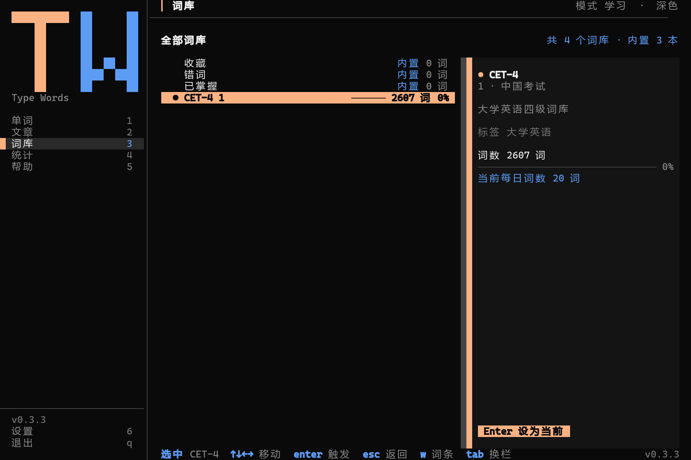 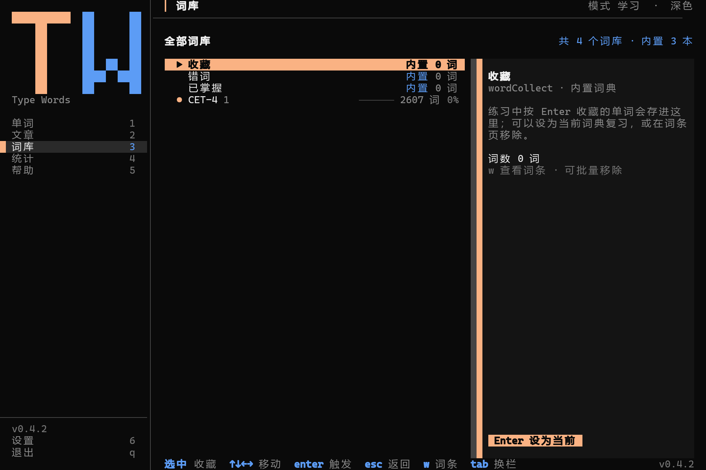

### 词条管理

从词库页按 `w` 进入（`w` 会先把选中条目设为当前词典），管理**当前学习词典**的词条：`↑` / `↓`（`j` / `k`）、`PgUp` / `PgDn`、`Home` / `End` 移动光标，`/` 聚焦搜索框（再按一次或 `Esc` 退出，页头显示「匹配 N / 总数」），`Enter` 编辑当前词条（单词 / 音标 / 释义 / 笔记四个字段，`Tab` 切换），`a` / `d` 新增 / 删除，空格勾选，`1` / `2` / `3` 批量标记认识 / 已掌握 / 不认识（需先勾选），`o` 切换排序（原序 → 正序 → 倒序 → 随机），`c` 复制成自定义词典，`n` 新建空词典，`Esc` / `q` 返回词库页。

自建与导入的词典都落在 `<home>/dicts/en/word/<id>.json`，因此会自动出现在词库页。资源词库的词条改动写回对应的词条文件（想保留改动请先 `c` 复制一份）；词数随词条数即时更新，词库页、主页磁贴与推荐列表取同一个数。三本内置词典页头标「（系统词典）」：词条本来就在 `dict.json` 里，搜索、编辑、删除与批量标记只改存档、不碰资源目录——删掉一个词就是从该词典里移除。

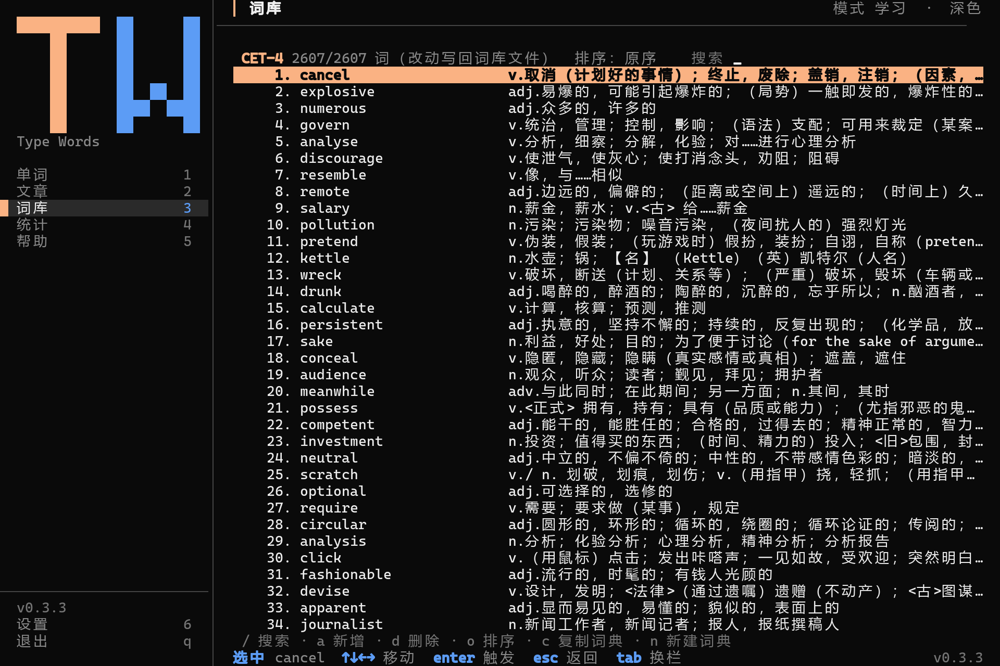

### 文章背诵

主页按 `a` 或数字 `2` 进入：左边是书本列表（书名与篇数，篇数取文章文件里的实际篇数，文件读不到时显示「篇数未知」），右边是当前书本里的文章。进页在左栏，`→` 切到右栏、`←` 切回，`Enter` 开始跟打；`Tab` 是「导航栏 ↔ 内容区」换栏。上次练过的文章会标「上次第 N 句」，选中它按 `Enter` 才从那一句继续，选别的文章则从头开始。

跟打页把整篇文章显示在同一页、逐句跟打：已完成的句子灰色显示，当前句行首有 `▶` 且视口自动跟随；顶部是标题、第几句、已完成 / 错误句数与用时，下方是当前句译文。需要输入字母与数字，标点不用打（按下会被忽略），词间空格可打可不打（省略空格后直接打下一个词首字母，空格自动按正确输入补上），连续空白只映射成一个空格。已输入正确的字符为绿色，打错字符标红并留在真正打错的位置，`Backspace` 可改正但错误标记保留。每完成一句自动朗读下一句（设置页「音频 → 文章朗读」，默认开启），`Ctrl+P` 随时朗读当前句；全部句子完成后弹出文章结算（指标是句数）。跟打中途返回或退出会把句子进度与用时存进 `practice-article.json`，整篇练完后自动清除；文章资源在 `assets/dicts/en/article/`，书目在 `assets/list/article.json`（内置《新概念英语1》5 篇）。

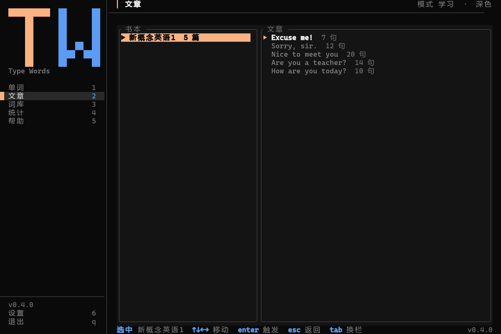 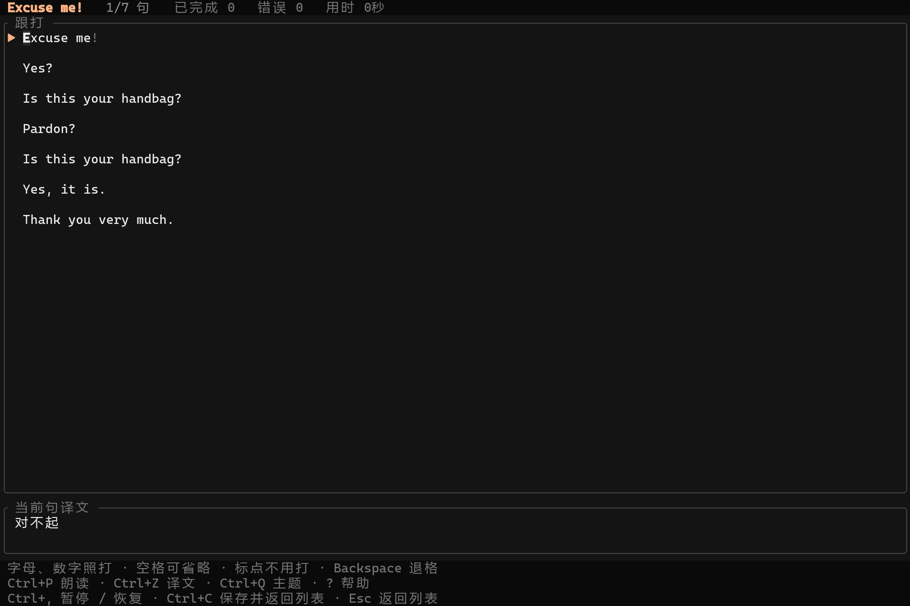

### 流程页

主页按 `Ctrl+F` 进入：左边是流程列表（7 个内置流程 + 自建流程），右边是选中流程的结构（节点 → 步骤）。`●` 只有一个含义——**下一轮练习实际会跑的流程**，所以它与顶栏「模式」永远一致。`↑` / `↓` 选流程（编辑时移动节点），`Enter` 启用，`n` 以选中流程为模板新建副本，`e` 进入 / 退出结构编辑（内置流程需先新建副本），`Delete` 删除自建流程，`]` 切换节点，编辑中 `h` / `l` 移动步骤光标、`a` / `d` 追加 / 删除步骤、`s` 切换「进入时乱序」、`g` 切换「组内巩固」，`Esc` 返回。启用自建流程只写 `flows.json` 的 `activeId`：在把练习模式切到「自定义流程」之前，那一行只标「（已启用）」、不带 `●`，页头写「已启用「X」，切到「自定义流程」后生效」；练习模式是「自定义流程」但还没有启用的自建流程时没有 `●`，页头写「当前：—（自定义流程模式尚未启用自建流程）」。练习模式是两种单词测试时页头写「当前：单词测试（4 选 1 答题，不经过流程编排）」。启用内置流程会直接把练习模式切到对应模式并清掉 `activeId`，所以要回到自建流程需重新启用一条；自建流程结构对应上游的 `PracticeFlowV2`（`{ activeId, flows }`），启用 / 新建副本的提示会说明本次是否已经生效。

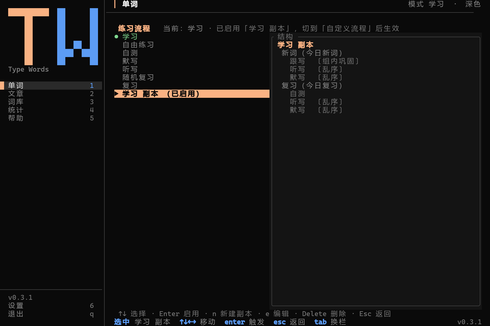

### 单词测试

练习模式为「单词测试」或「随机单词测试」时，主页按 `Enter` 进入专用答题页（不加载任何流程）：一题四个中文释义选项，用 `1`~`4` 选择（走键位表的 `ChooseA`~`ChooseD`，可改绑），空格进入下一题，`Ctrl+P` 朗读当前题答案词，`Esc` / `q` 退出；每题最多 100 道。答对 / 答错各有一声提示音，答错的单词自动进入错词本。「单词测试」用今日任务的复习词作题面（没有复习词时退回整本词库）；「随机单词测试」始终用整本词库打乱；候选池始终是整本词库。全部答完给出结算，结算里的「学习进度」显示当前词典的真实进度（`已学 N / M` 与百分比同源），不是「学习进度 0 / 题目数」。

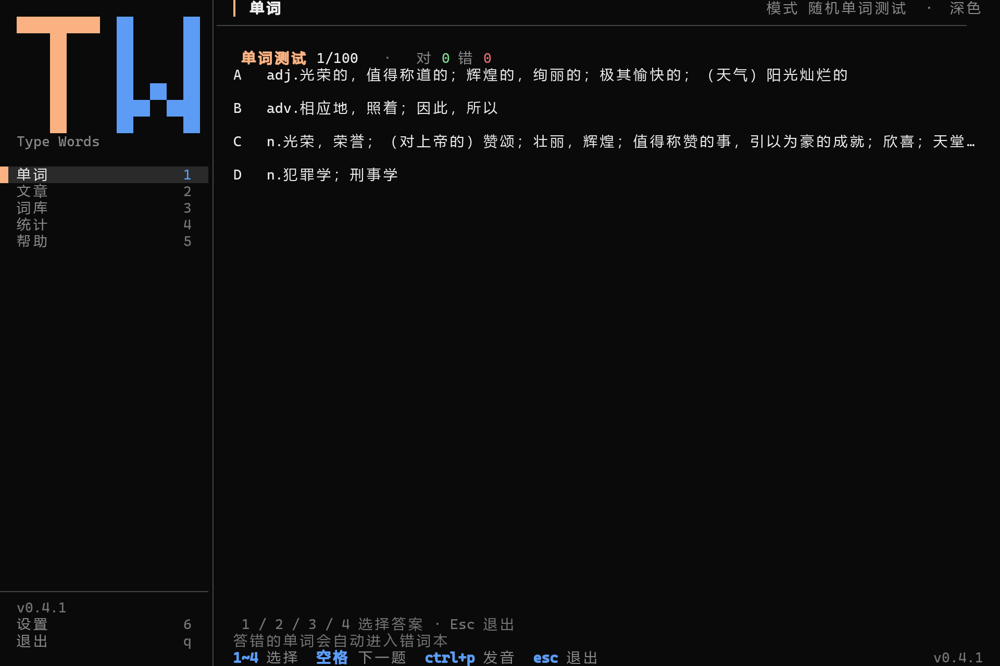

### 统计页

6 块总览卡：累计时长、学习天数、新词、复习、错误、正确率，其中新词 / 复习 / 错误带今日增量；下方「最近 14 天」列出**最近 14 个有记录的自然日**（不是固定 14 天窗口），每行是日期、用时条、用时与新 / 复 / 错计数。正文一屏放不下时右侧出现滚动条，用滚轮（或 `PgUp` / `PgDn`）滚动正文，点滚动条滑块上下的轨道每次滚一行；一屏放得下时没有滚动条，方向键与滚轮也滚不动。

日历里的方向键按**格子**走，不按日期 ±1 走：`↑` / `↓` 选上面 / 下面那一周的同一列（日期 ±7），`←` / `→` 选左面 / 右面那一天；到日历边缘停住，不跨月、不回绕。最左边那一格（周一，或月初 1 号）左边没有日期，再按 `←` 直接回到导航栏的「统计」页签（窄屏回顶栏）；窄屏第一周再 `↑` 也按通用规则回顶栏。`,` / `.` 翻月，翻月或选中日期后正文会自动滚到日历、保证选中的那天可见。`Enter` 与 `v` 一样切换「日历 / 按词典」视图；按词典视图没有日期，`↑` / `↓` 保持滚动正文、`←` / `→` 没有横向动作（宽屏左边缘 `←` 仍回侧栏）。`Esc` 返回。

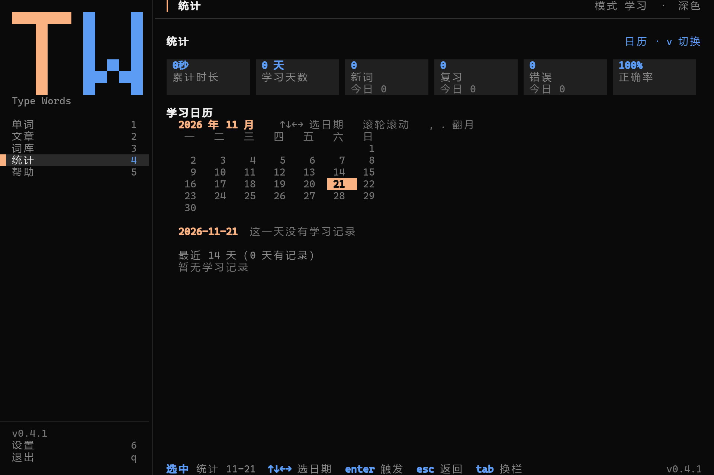

### 设置页

单列表格，按「通用 / 音频 / 复习 / 键入 / 显示 / FSRS / 其他」分区，共 33 行（31 个配置项 + 2 个动作项），每行「名称 + 当前值」；列表一屏放不下时右侧出现滚动条并跟随光标，放得下时没有滚动条。`↑` / `↓` 移动，`Enter` 或空格修改——开关直接切换、模式 / 主题 / 音标循环切换、数字类弹输入框（`Enter` 保存、`Esc` 取消），两个动作项弹确认；「快捷键」与「FSRS → 高级 FSRS」是入口行，分别打开快捷键页与高级 FSRS 页；每次修改立即保存。逐项的配置键、默认值、取值范围与生效方式见 [设置项参考](settings.md)。

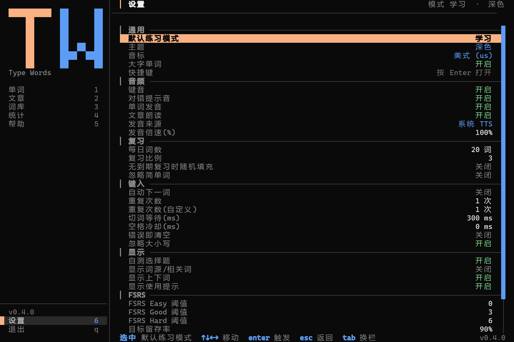

### 高级 FSRS 页

设置页「FSRS → 高级 FSRS」按 `Enter` 进入（右侧提示「按 Enter 打开」），外壳与其它标签页一致、侧栏高亮「设置」。内容区是一张 26 行的单列表格，分「留存率与间隔」「调度开关」「权重 w（FSRS-6）」「重置」四段：前两段各 2 行，`w[0]` ~ `w[20]` 共 21 行（右侧显示当前值与合法区间），最后一行是「恢复默认 FSRS 参数」。

- **按键**：`↑` / `↓`（`j` / `k`）移动，`PgUp` / `PgDn` 翻 10 行，`Home` / `End` 到首末；列表一屏放不下时右侧出现滚动条（跟随光标），放得下时没有；`Enter` 或空格修改当前行；`Esc` / `q` 保存并返回设置页（设置页光标回到第一行）。底栏显示「选中 X」，如「选中 w[12] 遗忘难度幂」。
- **怎么改**：目标留存率、最大间隔按数字输入（`Enter` 保存、`Esc` 取消，超出范围静默夹取）；fuzz 与短期调度两个开关直接切换；权重弹输入框并预填当前值，只接受数字与一个小数点，非法输入提示「请输入数字：如 0.212」并保留原值，超出范围按区间夹取并提示（如「w[0] 已夹取到 0.001 ~ 100」）；「恢复默认 FSRS 参数」弹确认，确认后 `fsrsParameters` 整组回默认——留存率、最大间隔、调度开关、21 个权重，以及页外的 `learning_steps` / `relearning_steps` 一起还原。
- **生效**：每次修改立即写入 `setting.json`，在**下一次结算**计算下次到期时生效，已排好的到期时间不变。`learning_steps` / `relearning_steps` 还没有界面入口，仍需退出程序后手改 `setting.json`（见 [设置项参考 · 仍需手改的 FSRS 参数](settings.md#仍需手改的-fsrs-参数)）。
- **鼠标**：第一次点行只是选中，再点已选中的行才修改；滚轮移动光标。

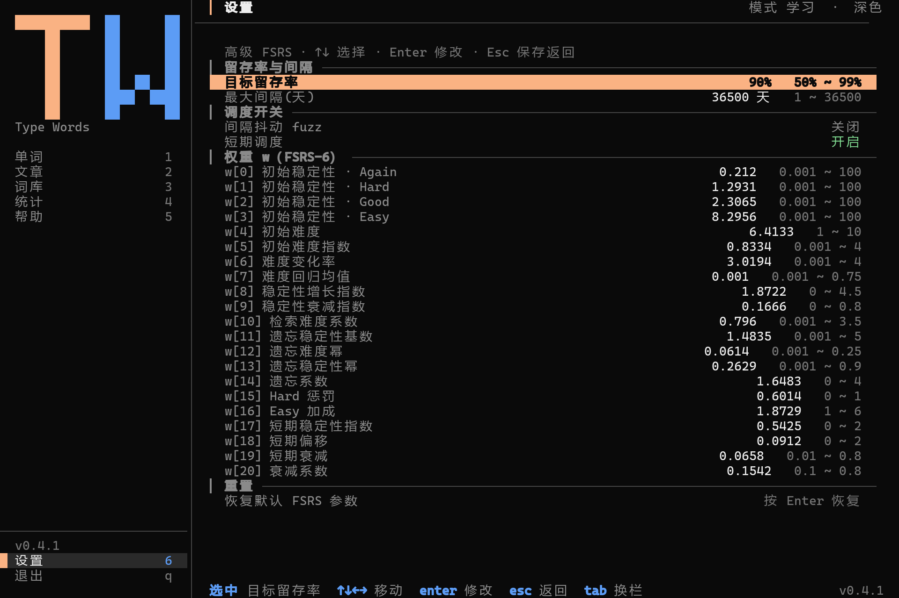

### 快捷键页

从设置页进入，列出全部可配置动作与当前键位：左侧动作名、右侧键位，选中行高亮；列表一屏放不下时右侧出现滚动条（跟随光标）。`Enter`（或空格）开始捕获新键位，再按一次目标键完成改绑，`Esc` 取消；`Delete` 清除当前绑定，`r` 恢复当前动作默认、`R` 恢复全部默认；`PgUp` / `PgDn` 翻 10 行、`Home` / `End` 到首末。依赖尚未实现功能的动作标注「（暂不可用）」。

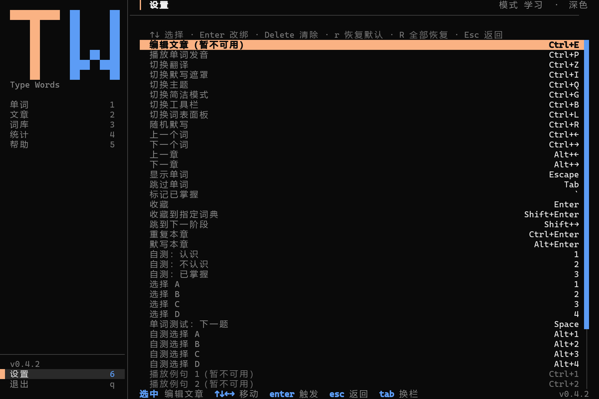

### 帮助页

帮助页分「快捷键」「常见问题」「关于与反馈」三个分页（上游把 FAQ / 关于 / 反馈拆成 help / about / feedback 三个页面，其中 about 与 feedback 渲染同一个组件，终端里合并成一个帮助页）。当前分页与其它页面的当前选中项同一套语言：键盘在本页时整块强调色高亮，焦点进导航栏后退回淡色底。`←` / `→`（`h` / `l` 别名）或点击顶部分页标签切换分页；分页到边后那一下交回焦点导航——宽屏在第一个分页再按 `←` 就回到侧栏，与其它页面「内容区最左 `←` 进侧栏」一致，最后一个分页再按 `→` 停住。`↑` / `↓`、`PgUp` / `PgDn` 与滚轮滚动当前分页；从其它页面打开帮助总是从「快捷键」分页开始（已在帮助页时点击当前导航项不重置分页）。

「快捷键」宽屏分「练习」「导航 / 查看」两栏，窄屏单栏并滚动；正文一屏放不下时右侧出现滚动条，点滑块上下的轨道每次滚一行（滑块本身不响应点击），内容放得下时没有滚动条。末尾是鼠标操作说明。「常见问题」回答终端形态下的常见疑问（数据位置与备份、联网与账号、平台、改键、发音、每日词数与复习、存档损坏、终端显示、手机 / 平板），「关于与反馈」给出项目与上游仓库、许可证、当前数据目录，以及提 issue 需要附带的诊断信息。`Tab` 仍是导航栏 ↔ 内容区换栏，内容区焦点下 `Enter` 返回（进导航栏后 `Enter` 触发选中项）；`Esc` 与其它任意键也返回（练习中进入则回练习，整屏帮助没有底栏，分页条右侧会再列一遍按键提示；窄到放不下时该提示落在分页条下一行）。

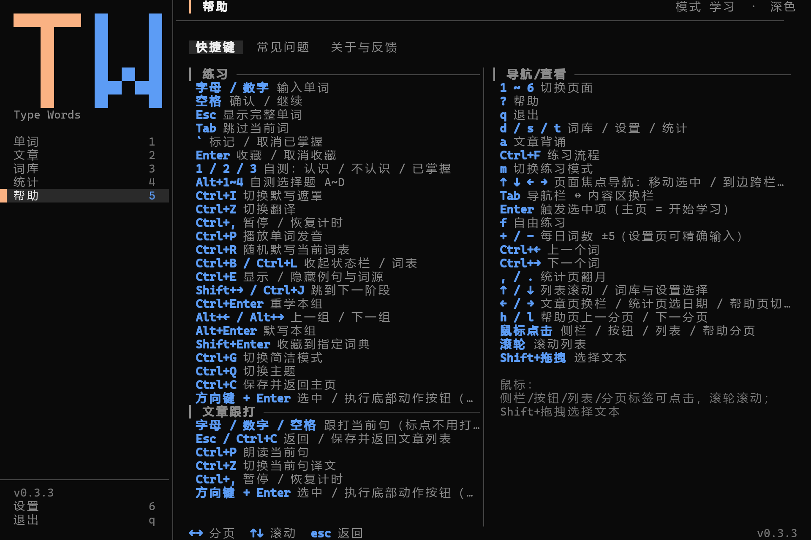  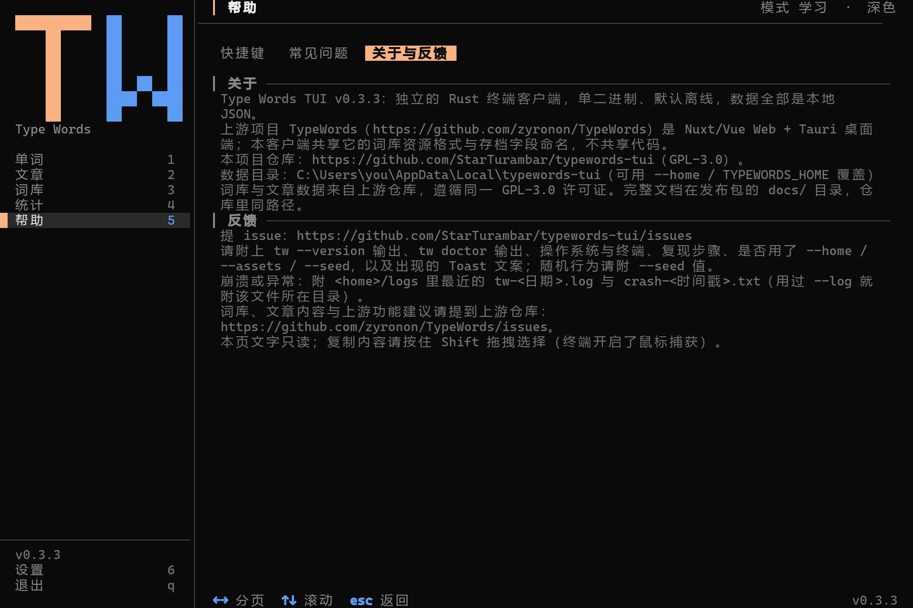

### 练习页

全屏布局，从上到下：

- **状态行**：词库 · 阶段（如「新词 · 跟写」「小组巩固」「错词巩固」）· 进度条 · 当前序号 / 总数 · 错词数（有错词时用警示色）· 计时（暂停时显示「已暂停」）。
- **单词区与信息卡片**：音标 → 状态徽标（本词错误次数 / 「★ 已收藏」）→ 大字单词（5×7 点阵，空间足够时 2 倍像素）→ 输入提示 → 相邻词（可关闭），下面是释义、例句、短语、近义词、词源 / 词根与笔记；已输入正确的字母为成功色、错误为错误色、下一个待输入字母为强调色，遮罩 / 默写模式下未输入字母显示空心方框，释义按词性分组、组内按词频倒序，超出高度以「…」截断。换到新词时自动朗读（受设置页「音频 → 单词发音」控制，默写阶段不朗读以免念出答案），`Ctrl+P` 随时重播。
- **底部阶段区与侧栏**：第一行是每个节点的进度条，下面是动作按钮条（显示 / 跳过 / 掌握 / 收藏 / 翻译 / 默写 / 暂停 / 重学 / 换组 / 返回，带当前键名），再下面是操作提示与 Toast，`Ctrl+B` 收起整块；`Ctrl+L` 展开右侧词表（`▶` 当前词、错词用错误色、已排除词用暗色）。

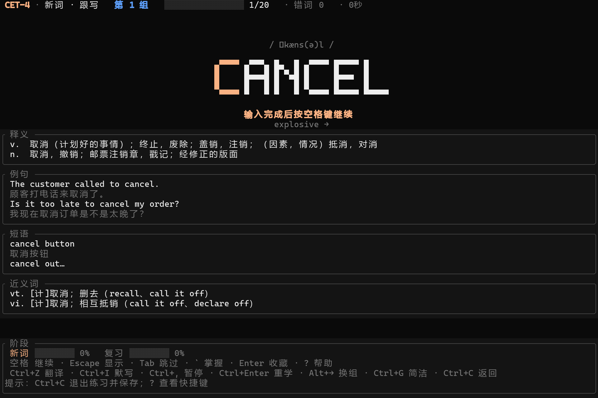  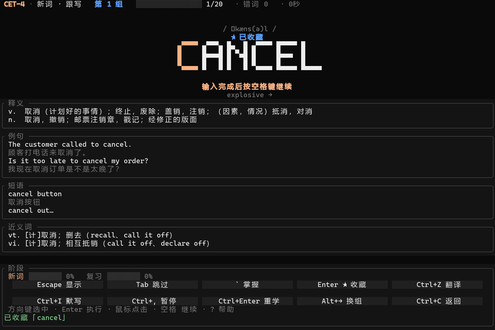

**动作按钮**（背单词页 10 个、文章跟打页 6 个，共用一套操作语言）：`←` / `→` 在本行内左右移动、`↑` / `↓` 在两行间上下移动（没有选中时按方向键落在第一个按钮上，到边停、不回绕），`Enter` 执行选中按钮，鼠标点哪个就执行哪个。按钮条只在「方向键」和「已选中时的 `Enter`」上生效：按其它任何键都会取消选中并照旧输入 / 执行快捷键，所以继续打字后 `Enter` 回到「收藏」的旧语义。方向键先给键位表和键入用，没人要时才用来选中按钮；按钮上的键名跟着键位表走。收藏时单词上方出现「★ 已收藏」徽标、底部弹 Toast、收藏按钮变成「★ 收藏」，三处读同一个收藏状态。

### 弹层

| 弹层 | 打开时机与内容 |
| --- | --- |
| 结算 | 一轮流程完成（单词会话 / 单词测试）或整篇文章跟打完：单词是学习时长、正确率、新词 / 复习 / 错词、学习进度与进度条、错词 Top10、本周记录，按钮「继续」「重学」「主页」；文章是「文章跟打完成」+ 标题、时长、正确率、「完成 N / M 句」「错句 N」、进度条、本周记录，按钮「返回列表」「重打本篇」「主页」 |
| 输入 / 确认 / 列表类 | 设置页与高级 FSRS 页改数字项时弹输入（`Enter` 保存、`Esc` 取消）；退出程序、清空练习进度、清除所有数据弹确认（默认选中「确认」）；主页 `m`、状态行「第 N 组」、`Shift+Enter`、词条页 `Enter` 打开模式 / 跳组 / 收藏目标 / 词条编辑，列表项用 `↑` / `↓` 选、`Enter` 确认、`Esc` 取消 |

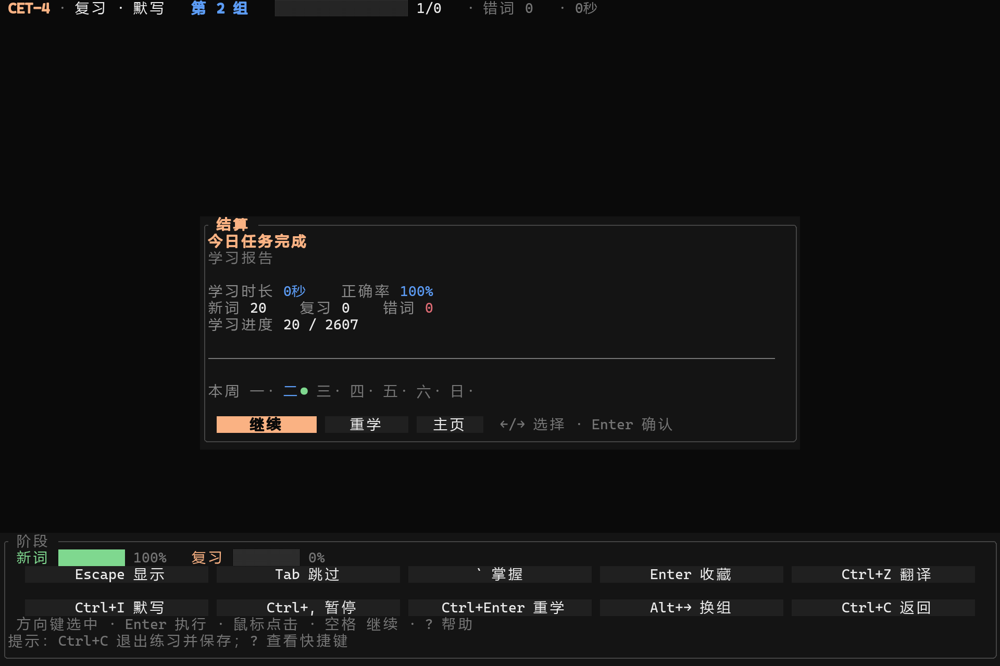 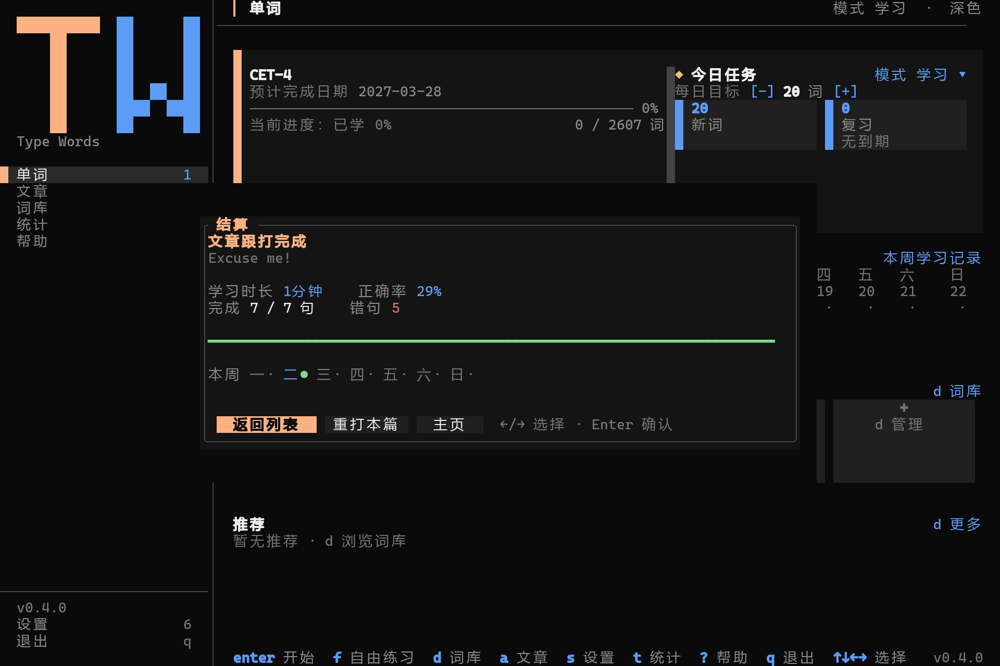

## 练习模式与流程

### 10 种练习模式

| 模式 | 词源 | 流程 |
| --- | --- | --- |
| 学习 `system` | 今日任务：新词 + 到期复习 | 新词：跟写（7 词小组 + 组内拼写）→ 听写 → 默写；复习：自测 → 听写 → 默写 |
| 自由练习 `free` | 今日任务整份词表（新词 + 复习） | 跟写（逐词推进，无小组循环） |
| 自测 `identify` / 默写 `dictation` / 听写 `listen` | 今日任务：新词 + 复习 | 分别是自测 / 默写 / 听写单步 |
| 随机复习 `shuffle` | 已学范围随机抽取（还没学词时取全词库），数量 = 每日词数 × max(复习比例, 1) | 默写 |
| 复习 `review` | 今日任务的到期复习词 | 自测 → 听写 → 默写 |
| 随机单词测试 / 单词测试 | 前者整本词库打乱；后者今日任务的复习词，没有复习词时退回整本词库 | 无（4 选 1 答题） |
| 自定义流程 `custom` | 由已启用的自建流程决定 | 自建流程编排 |

- **选择方式**：主页 `m`（或点「模式 X ▾」）打开弹层，`↑` / `↓` 选、`Enter` 确认，写进 `setting.json` 的 `wordPracticeMode`；`--mode` 只接受 7 个内置流程模式。自由练习（`f`）不改默认模式，只跑一轮。
- **10 种模式 vs 7 个内置流程**：流程页只列 `system` / `free` / `identifyOnly` / `dictationOnly` / `listenOnly` / `shuffle` / `review` 这 7 条（`BUILTIN_FLOW_MODES`，`src/domain/flow/mod.rs`）；两种单词测试与「自定义流程」没有内置 flow，两种单词测试不走流程编排、直接进答题页，没有阶段条、没有错词巩固，答错自动进错词本。
- **「启用」与「生效」是两件事**：启用自建流程只写 `activeId`；把练习模式切到「自定义流程」后下一轮才按它编排。启用内置流程会切换练习模式并清掉 `activeId`。

### 阶段与 7 词小组

学习模式的新词节点是「跟写（每 7 词一组）→ 组内拼写巩固 → 下一组 … → 听写 → 默写」，复习节点是「自测 → 听写 → 默写」。「跟写」按 7 词一组推进（`GROUP_SIZE`）：整组跟写完后，同一组立即以「拼写」形式再练一遍（单词被遮挡、只显示释义），状态行显示「小组巩固」；不足 7 词的尾组自成一组。其余步骤逐词推进，听写、默写步骤进入时会洗牌；底部阶段条按节点显示进度，状态行显示当前「节点 · 步骤」。前进 / 回退：`Ctrl+→`（别名 `Ctrl+N`）下一个词、`Ctrl+←` 上一个词、`Shift+→`（别名 `Ctrl+J`）跳过当前阶段剩余词。

### 错词巩固与自测

任何阶段结束仍有错词时，不进入下一阶段，而是自动进入「错词巩固」：把本阶段错词重新练一遍，固定使用「跟写 + 7 词小组 + 组内拼写」，直到错词清空，期间可能反复循环并提示「还有错词，继续巩固一下吧」；错词自动收录进系统词典「错词」，不计入每日词数与本轮任务词数。自测阶段单词被遮挡，卡片给出中文释义选项（A~D，词库很小或释义重复时可能少于 4 个）：`Alt+1`~`Alt+4` 选择，也可以直接拼写整个单词；`1` 我认识（显示单词，按 Good 记录）、`2` 不认识（计一次错误）、`3` 已掌握（加入已掌握词典并自动进下一词），选择或回答后按空格继续。直接拼写会先揭晓答案并计一次错误，急着过词时优先用 `1` / `2` / `3` 或选择题；关闭设置「自测选择题」后不显示 A~D。

### 结算

两种结算共用同一个弹层：单词会话 / 单词测试的**学习报告**，与整篇文章跟打完的**文章结算**。按钮焦点：`←` / `↑` / `k` / `Shift+Tab` 左移、`→` / `↓` / `j` / `Tab` 右移（到边停、不回绕），`Enter` / 空格执行；默认选中第一个按钮（单词是「继续」、文章是「返回列表」）。单词结算还可直接按 `r` 重学、`q` / `Esc` 回主页；文章结算按 `r` 重打本篇、`q` / `Esc` 回主页。

- **继续**：所结束的会话是随机复习时重新抽词，否则按当前默认练习模式生成今日任务；没有可练的词时提示「没有可学习的单词！」并回主页。**重学**：回退本轮新词的学习进度、保留收藏与错词，重练本轮词表。
- **学习进度**是单词结算的显示项之一（文章结算按句数，没有它）：`已学 N / M` 与百分比同源，分母都是当前词典的有效词数，词典学完时固定 100% 并显示「已完成」；文章结算的错句 = 出现过错误的句子数，正确率 = (完成句数 − 错句数) / 完成句数（一句都没完成时记 100%）。结算后本轮统计写进 `dict.json`、断点缓存被删除。单词结算同时写回 FSRS 卡片（正确率按「(总词数 − 错词词数) / 总词数」，错词按本轮出错的不同单词数统计）；文章结算只写当天的学习记录（带文章标题，没有 FSRS 评级）。错词 Top10 按本轮错误次数倒序；本周记录只统计当前词典（统计页是跨词典累计）。

### 断点续练

- 练习中每次推进后约 500ms 防抖保存，每累计 30 秒学习时间再保存一次；`Ctrl+C`、退出程序或切回主页时立即保存。
- **启动固定在主页，不会自动进入练习页**：缓存存在且词库、流程、词表都匹配时，主页显示「上次任务 / 继续学习」，按 `Enter` 才回到同一词、同一阶段。同一次运行内退出练习页回主页后再按 `Enter` 也是接着练；自由练习（`f`）例外，它明确要开一轮新的。恢复失败会丢弃缓存并从新会话开始：换过词库、词已不在当前词库、游标与流程不匹配时静默；缓存版本不符时启动弹告警后丢弃。统计的落盘时机是「练完结算」——中途退出时这段时间留在缓存里。`--reset-practice` 或设置页「清空当前练习进度」清掉两个断点缓存，学习进度、统计与 FSRS 卡片不受影响；计时在 3 分钟无操作后自动暂停，按 `Ctrl+,` 恢复。

### 每日词数与单词标记

| 操作 | 入口 | 行为与落盘 |
| --- | --- | --- |
| 每日词数 | 主页 / 词库页 `+` / `-`（每次 ±5）；设置页「复习 → 每日词数」精确输入 | 写入 `dict.json` 当前学习词典的 `perDayStudyNumber`（不是 `setting.json`），范围 1 ~ 当前词库词数；决定每日新词数与复习上限 |
| 跳过 / 收藏 / 已掌握 | `Tab` / `Enter` / 反引号键 | 跳过只把词加入本轮排除列表、下一轮重现；收藏写系统词典「收藏」；已掌握写「已掌握」并立即排除、不再出现在今日任务；输入错误 / 不认识 / 显示答案会把词收录进「错词」，状态行显示本轮错词数，阶段末触发错词巩固 |

每日词数的**显示值**会按当前词库词数夹取（至少 1），主页、词库页详情与设置页显示的都是这个值，`+` / `-` 也以它为基准——换到更小的词库后按 `-` 会从夹取后的值继续减。显隐类按键（`Ctrl+Z` 翻译、`Ctrl+I` 默写遮罩、`Ctrl+E` 例句与词源、`Ctrl+L` 词表、`Ctrl+B` 阶段条）只对当前词 / 当前阶段有效，切换单词或阶段恢复阶段默认。

### FSRS 对复习的影响（用户视角）

结算时按本轮每个词的错误次数评级：默认 0 次 Easy、1~3 次 Good、4~6 次 Hard、7 次及以上 Again（阈值在设置页 FSRS 分区调整），自测回答「认识」或选对答案的词强制记为 Good。评级决定下次到期：新词评 Easy 直接毕业（间隔至少 1 天），Good / Hard / Again 走学习步进；学习中的词评 Easy / Good 毕业进入复习；复习卡评 Hard / Good / Easy 走 FSRS 间隔，评 Again 进入重学。复习按本地自然日判断到期（due ≤ 今天即到期），按到期时间从早到晚取「每日词数 × 复习比例」个；没有到期复习且未开启随机填充时主页显示「无到期」。评级映射与间隔由 `src/domain/fsrs.rs` 自实现的 FSRS-6 计算，已逐条对齐上游 ts-fsrs；参数与阈值含义见 [设置项参考](settings.md)，与上游的差异见 [与上游对照](upstream-parity.md)。

## 按键参考

练习页与单词测试页的键位走键位表：**42 个动作**都可以在 设置 →「快捷键」里改绑（`Enter` 改绑、`Delete` 清除、`r` / `R` 恢复默认），改绑后按钮上的键名同步变化。完整动作表、默认绑定与 TUI 专有键见 [快捷键](shortcuts.md)；下表是练习页默认绑定。

### 练习页按键

| 键 | 动作 | 说明 |
| --- | --- | --- |
| 字母 / 数字 / 符号 / 空格 / 退格 | 输入单词 | 带 `Ctrl` / `Alt` 的组合键不进输入 |
| 空格 | 确认 / 继续 | 输入完成后按空格推进；默写 / 听写先揭晓再按一次继续 |
| `Esc` | 显示完整单词 | 遮罩状态或非跟写阶段计一次错误（同一词同一阶段只计一次） |
| `Tab` | 跳过当前词 | 不计输入数、不算错，本轮不再出现 |
| `Enter` | 收藏 / 取消收藏 | 写入「收藏」词典，单词上方出现「★ 已收藏」徽标并弹 Toast |
| 反引号键 | 标记 / 取消「已掌握」 | 标记后自动进入下一词 |
| `1` / `2` / `3`、`Alt+1`~`Alt+4` | 自测：我认识 / 不认识 / 已掌握、选择题 A~D | 仅自测阶段生效 |
| `Ctrl+Z` / `Ctrl+I` / `Ctrl+E` / `Ctrl+L` / `Ctrl+B` / `Ctrl+G` | 翻译 / 默写遮罩 / 例句与词源 / 词表 / 阶段区 / 简洁模式 | 只对当前词有效；词源还需设置项开启；简洁模式同时隐藏阶段条与词表 |
| `Ctrl+P` / `Ctrl+,` | 播放单词发音 / 暂停与恢复计时 | 换词时也会自动朗读（默写阶段除外）；暂停时状态行显示「已暂停」 |
| `Ctrl+R` / `Ctrl+O` / `Ctrl+Q` / `Ctrl+C` | 随机默写 / 编辑笔记 / 切换主题 / 保存并返回主页 | 笔记弹层 `Enter` 保存、清空即删除；`Ctrl+C` 不是退出程序 |
| `Ctrl+→`（别名 `Ctrl+N`）/ `Ctrl+←` / `Shift+→`（别名 `Ctrl+J`） | 下一个词 / 上一个词 / 跳到下一阶段 | 组合键被吞时用别名；后者跳过当前阶段剩余词 |
| `Ctrl+Enter` / `Alt+←` / `Alt+→` / `Alt+Enter` | 重学本组 / 上一组 / 下一组 / 默写本组 | 都按组重建会话 |
| `Shift+Enter` / `?` | 收藏到指定词典 / 帮助 | 前者弹层里选目标词典；状态行的「第 N 组」可点击，弹层里 `↑` / `↓` 选、`Enter` 跳组 |

### 文章跟打页按键

跟打页与练习页**共用同一套键位表**：`Ctrl+P` 朗读、`Ctrl+Z` 切换当前句译文、`Ctrl+Q` 切换主题、`Ctrl+,` 暂停 / 恢复、`Ctrl+C` 保存并返回文章列表、`?` 帮助，改绑后两页一起变。唯一的差别是 `Esc`：练习页的它绑成「显示单词」，跟打页没有遮罩，保持全站通用的「返回文章列表」（先写一次断点缓存）。底部动作按钮为朗读 / 翻译 / 主题 / 暂停 / 帮助 / 返回，操作与练习页一致。

### 其它页面按键

所有标签页共用的焦点键（有弹层、练习中、词条搜索框输入时让位）：`↑` / `↓`（别名 `k` / `j`）当前栏内移动选中（统计页按日历换周）；`←` / `→` 页面横向操作（文章页换栏、统计页按日历换天），宽屏内容区左边缘、统计页日历左边缘再 `←` 进导航栏（窄屏进顶栏）；`Tab` / `Shift+Tab` 导航栏 ↔ 内容区换栏；`Enter` 触发选中项（导航栏里切换页面，落在当前页只提示）；`Esc` 主页取消选中、其它页面返回上一层。

| 页面 | 键 | 动作 |
| --- | --- | --- |
| 主页 | `f` / `d` / `s` / `t` / `a` / `m` / `Ctrl+F` / `+` / `-` / `1`~`6` / `?` / `q` | 自由练习 / 词库 / 设置 / 统计 / 文章背诵 / 模式选择 / 练习流程 / 每日词数 ±5 / 切页 / 帮助 / 退出（弹确认） |
| 词库页 | `Enter` / `w` / `n` / `+` / `-` / `Esc` / `q` | 设为当前词典 / 词条管理 / 新建自定义词典 / 每日词数 ±5 / 返回 |
| 词条页 | `/`、空格、`a` / `d`、`1` / `2` / `3`、`o` / `c` | 搜索 / 勾选 / 新增 / 删除 / 标记 / 排序 / 复制词典 |
| 统计页 | 方向键、`PgUp` / `PgDn`、`,` / `.`、`v` / `Enter` | 日历里按格子选日期 / 正文翻 5 行（滚轮同效）/ 翻月 / 切换视图 |
| 设置页 | 空格 | 修改当前项（与 `Enter` 同效） |
| 流程页 | `n` / `e` / `Delete`、`]`、编辑中 `h` / `l` / `a` / `d` / `s` / `g` | 复制 / 编辑 / 删除、切换节点、移动步骤光标 / 加删步骤 / 乱序 / 组内巩固 |
| 快捷键页 | `Enter` / 空格、`Delete`、`r` / `R`、`PgUp` / `PgDn`、`Home` / `End` | 开始捕获 / 清除绑定 / 恢复当前或全部默认 / 翻 10 行 / 到首末 |
| 高级 FSRS 页 | `Enter` / 空格、`PgUp` / `PgDn`、`Home` / `End`、`Esc` / `q` | 修改当前行（数字 / 权重弹输入、开关直接切换、重置弹确认）/ 翻 10 行 / 到首末 / 保存并返回设置页 |
| 单词测试页 | `1`~`4`、空格、`Ctrl+P`、`Esc` | 选 A~D / 下一题 / 朗读答案词 / 退出 |
| 帮助页 | `←` / `→`（`h` / `l`）、`↑` / `↓`、`PgUp` / `PgDn`、滚轮、其它任意键 | 切换分页 / 滚动当前分页 / 返回上一层（分页到边时 `←` 回侧栏、`→` 停住） |

**方向键语义**（两栏 × 主轴；到边停、不回绕；有弹层时不生效）：宽屏侧栏 `↑` / `↓` 换项、`→` 回内容区；窄屏顶栏 `←` / `→` 换标签、`↓` 回内容区；主页内容区按视觉行带上下移动、同带内左右移动；其它页面内容区走页面自己的光标与横向操作，没有横向操作或到左边缘时 `←` 进侧栏（统计页日历的左边缘在窄屏也直接回顶栏）；统计页是例外：`↑` / `↓` / `←` / `→` 都在日历格子里移动，不滚动正文。进入任何标签页都默认选中内容区（主页是「开始 / 继续学习」）。帮助页另有自己的横向键语义：内容区焦点下它的 `←` / `→` 先用于切换分页，分页到边后的那一下仍按本规则跨栏（宽屏第一个分页再 `←` 进侧栏、最后一个分页再 `→` 停住）；`Tab` 进导航栏后，方向键恢复焦点导航（窄屏顶栏靠 `←` / `→` 换页签）。

### 弹层按键与按键优先级

| 弹层 | 键 | 鼠标 |
| --- | --- | --- |
| 确认 | 方向键 / `Tab` 选按钮，`Enter` / 空格执行；`y` 直接确认，`n` / `Esc` 取消，其它任意键取消 | 点「确认 / 取消」；点弹层外取消 |
| 输入 / 结算 / 列表类 | 输入：数字、`Backspace`、`Enter` 保存、`Esc` 取消；结算：方向键 / `Tab` 选按钮后 `Enter` / 空格执行，单词结算另有 `r` 重学、`q` 回主页，文章结算另有 `r` 重打、`q` 回主页；列表类：`↑` / `↓` 选、`Enter` 确认、`Esc` 取消 | 结算只响应三个按钮；输入点弹层外取消；列表类可点项选中（点弹层外不关闭） |

1. **弹层优先，练习页优先于页面键位**：有弹层时除该弹层支持的键外其它按键不生效；进入练习后 `1`~`6`、`s`、`t` 等不再是快捷键，而是输入字符，`1` / `2` / `3` 只在自测阶段被解释为选项。
2. **数字切页**：`1`~`6`（1 单词 / 2 文章 / 3 词库 / 4 统计 / 5 帮助 / 6 设置）仅在无练习会话、无弹层、且当前页占用数字键时切页（主页 / 词库 / 统计 / 设置 / 文章）；帮助页的「任意键返回」优先于数字切页，练习中进入帮助后返回练习页。**组合键被吞与全角标点**：`Alt+数字`、`Ctrl+方向键`、`Ctrl+Enter` 在部分终端 / 输入法下无事件，可用 `Ctrl+N` / `Ctrl+J` 别名、直接拼写、结算弹层的 `r` 代替；输入会按目标字符归一化（全角问号、引号可当半角），大小写按「忽略大小写」设置。

## 鼠标操作

启动时程序会开启终端鼠标捕获。支持范围：宽屏侧栏 / 窄屏顶栏的页面标签；主页「开始 / 继续学习」「f 自由练习」、每日目标 `[-]` / `[+]`、区块入口「d 词库」「d 更多」；词库页「Enter 设为当前」；确认 / 结算弹层的按钮；练习页与文章跟打页底部的动作按钮（点哪个执行哪个，选中同时落到被点的按钮上）。

- **列表与滚轮**：词库页、设置页与高级 FSRS 页的行——**第一次点击选中该行，再次点击已选中的行才激活**（词库页设为当前词典并回主页，设置页与高级 FSRS 页修改该项），也可以选中后按 `Enter`。统计页点日历某一天选中该日、页头「v 切换」切视图；流程页点流程行选中；文章页点书本 / 文章行选中；单词测试页点 A~D 作答；词条管理页点行选中，点已勾选行则取消**那一行**的勾选。滚轮在词库页 / 设置页 / 高级 FSRS 页移动光标，统计页滚动正文（日历 / 当日明细 / 最近记录；方向键只选日期不滚正文），帮助页滚动当前分页，词条管理页 / 快捷键页 / 流程页滚动列表，文章页按指针所在栏滚动；练习页与主页忽略滚轮。有滚动条的页面还能直接点滑块上下的轨道，一次滚一行。
- **弹层与帮助页**：模式选择、收藏到指定词典、词条编辑三个弹层可点列表项（点弹层外不关闭）；确认弹层点哪个按钮就执行哪个（与键盘当前选中无关），点弹层外取消；输入弹层点弹层外取消；结算弹层只响应三个按钮。帮助页正文只读，点击内容区不会退出；顶部分页标签可点（切换分页），右侧滚动条滑块上下的轨道可点（每次滚一行），返回用键盘或导航切页。

## 设置与主题

- **进入设置**：主页按 `s` 或 `6`，或点击侧栏「设置」；练习中不能进入，先回主页。`Esc` / `q` 保存并返回。每次修改立即保存（「每日词数」写 `dict.json`，其余写 `setting.json`）；「清空当前练习进度」删两个断点缓存，「清除所有数据」把两份主存档恢复默认并删断点缓存（**不可撤销**）。设置项细节见 [设置项参考](settings.md)；「FSRS → 高级 FSRS」打开高级 FSRS 页，可改目标留存率、最大间隔、调度开关与 21 个权重。
- **主题**：设置页「主题」一行循环 `auto` → 6 套内置（深色、浅色、高对比、午夜墨、纸墨、克莱因蓝）→ 自定义主题；`--theme NAME` 可覆盖，未知名字回退深色并 Toast；练习页 / 跟打页 `Ctrl+Q` 随时循环，`auto` 始终解析为深色。自定义主题把 `*.json` 放进 `<home>/themes/`，启动时加载，新增或修改后需重启；校验失败只跳过该文件并告警，`tw doctor` 可查看清单与告警，格式与 token 见 [主题系统](themes.md)。

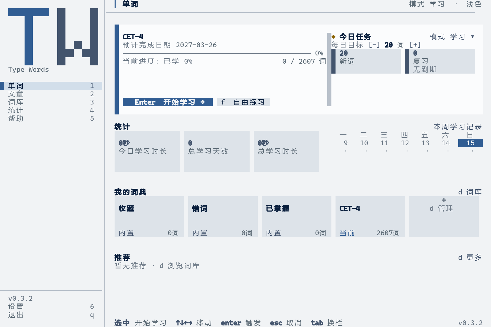 

## 数据与备份

| 路径 | 内容 |
| --- | --- |
| `<home>/dict.json` | 词典元数据与词表、学习进度、FSRS 卡片、收藏 / 错词 / 已掌握、统计 |
| `<home>/setting.json` | 设置项（含主题与练习模式选择） |
| `<home>/practice-word.json` / `practice-article.json` | 单词 / 文章断点缓存 |
| `<home>/flows.json`、`<home>/.tw.lock`、`<home>/themes/`、`<home>/dicts/`、`<home>/list/` | 自建练习流程（无版本号）、数据目录锁（内容是持锁进程 PID，常驻不删）、自定义主题、导入的词条文件与用户词库目录 |
| `<home>/logs/` | 运行日志 `tw-<日期>.log` 与崩溃报告 `crash-<时间戳>.txt`；**不是存档**，删了不影响学习进度，详见[日志与崩溃报告](#日志与崩溃报告) |

- **备份 / 迁移**：先退出所有 tw 实例，再复制整个数据目录（锁文件与 `logs/` 可留可删——日志与崩溃报告不属于存档）；恢复或换机器时把备份目录放回原路径，或用 `--home` / `TYPEWORDS_HOME` 指向备份目录。重置与损坏：删 `practice-word.json` 只清断点缓存（等价 `--reset-practice`）；删 `setting.json` 恢复默认设置；删 `dict.json` 会丢失学习进度、统计、FSRS 卡片与三本系统词典（谨慎）。存档损坏会被重命名为 `*.corrupt-<时间戳>.json` 并回退默认值；版本过高的 `dict.json` / `setting.json` 本次运行只读、不覆盖；练习缓存版本不符会被忽略。设置页「清除所有数据」等价于把两份主存档恢复默认，不需要手工删文件；完整字段与版本策略见 [存档与数据格式](persistence.md)。

## 常见问题与排障

### 排障表

| 现象 | 可能原因 | 处理 |
| --- | --- | --- |
| 启动报「找不到词库资源目录」 | `assets/` 不在可执行文件同级或当前目录，`--assets` 指向的目录没有 `list/word.json` | 把 `assets/` 放到可执行文件同级（Windows 为 `tw.exe`，Linux / macOS 为 `tw`），或用 `--assets` 指向包含 `list/word.json` 的目录 |
| 启动报「加载词库失败」 | 存档里的当前词库在资源目录中找不到，或词条文件缺失 | `tw doctor` 看每本词库的「文件」路径；用 `--dict` 指定存在的词库 |
| 启动提示「另一个实例正在使用该数据目录」 | 同一个 `--home` 已经有 tw 在运行（TUI、`tw task` 或导入命令） | 退出那个进程；或换一个 `--home`（`tw doctor` / `tw export-dict` / `tw export-web` 只读，本来就允许同时运行） |
| 启动无反应 / 一直黑屏 | 终端小于 60 × 20 只显示提示；或进程还在装载大词库 | 放大窗口；等待首帧；`Ctrl+C` 退出后重试 |
| 退出后终端显示错乱 | 进程被强制结束，未恢复备用屏幕 / 鼠标捕获 | 重开终端；Unix 可执行 `reset` |
| 中文 / 边框错位、颜色发灰偏色 | 终端字体非等宽或不支持 CJK / 制表符、使用 conhost；终端不支持 24-bit 真彩色 | 换 Windows Terminal 并设置等宽且支持中文的字体；确认 `COLORTERM=truecolor`，或换「高对比」/ 自定义 ANSI 颜色主题 |
| 鼠标点击没反应 / 无法复制文本 | 终端不支持鼠标上报，或点击位置不是可点目标；程序开启了鼠标捕获 | 用键盘；练习页只有底部动作按钮、词表行与「第 N 组」可点；按住 `Shift` 拖拽选择文本（个别终端用 `Alt` 或关闭鼠标上报） |
| 组合键无效（`Alt+数字`、`Ctrl+方向键`、`Ctrl+Enter`） | 终端或输入法拦截了组合键 | 用 `Ctrl+N` / `Ctrl+J` 别名、自测直接拼写；「重学本组」用结算弹层的 `r` 代替 |
| 提示「存档已损坏，已隔离」 | 存档 JSON 损坏 | 坏文件已改名 `*.corrupt-<时间戳>.json`，可删除或用于排查；程序已回退默认值 |
| 提示「存档版本过高」 | 存档来自更新版本的程序 | 升级程序；`dict.json` 与 `setting.json` 本次都只读、不会被覆盖，先备份再升级 |
| 提示「没有可学习的单词！」 | 没有新词且没有到期复习（全部学完或标记已掌握）；当前词典是内置词典「已掌握」时必然如此 | 换词库、取消已掌握标记、开启「无到期复习时随机填充」，或用随机复习 / 自由练习 / 随机单词测试 |
| 练习 / 单词测试没有发音，或安全软件弹「隐藏执行 PowerShell」 | 「单词发音」被关掉；系统 TTS 不可用（Windows 上通过 PowerShell 调 `System.Speech`，安全软件的「系统加固」会拦脚本引擎） | 确认设置页「音频 → 单词发音」开启，按 `Ctrl+P` 手动重播以区分「自动朗读没触发」与「TTS 无声」；关掉「文章朗读」或对 `tw.exe` 放行一次并记住 |
| 每日词数调不动 | 已到 1 ~ 当前词库词数的边界，或当前词库未加载 | 词库页先「设为当前」；用设置页「复习 → 每日词数」直接输入（保存时按范围夹取） |
| 学习记录 / 统计清不掉 | 「清空当前练习进度」与 `--reset-practice` 只清断点缓存，不碰 `dict.json` | 用设置页「其他 → 清除所有数据」（不可撤销） |
| macOS 打开被拦（提示「无法验证开发者」或「已损坏」） | 发布包未签名，从浏览器下载的二进制带 quarantine 隔离属性 | 先按「下载发布包」校验 sha256，再执行 `xattr -d com.apple.quarantine ./tw` |
| Linux 运行报 `GLIBC_2.3x not found` | 发行版 glibc 比构建基线（Ubuntu 22.04）旧，`x86_64-unknown-linux-gnu` 包跑不起来 | 改用 `x86_64-unknown-linux-musl` 静态包，不依赖系统 glibc |
| 解压后没有执行权限（Permission denied） | 解压工具没保留可执行位，或手动复制过二进制 | 执行 `chmod +x tw` 后再运行 |
| Windows 双击启动窗口一闪而过 | 早期错误或 panic 后进程立刻退出，控制台窗口随之关闭 | 看 `<home>/logs/` 里的日志与 `crash-*.txt`；双击启动本应显示「按回车键退出...」并等待回车，没有停住说明是带参数启动或设置了 `TW_NO_PAUSE` / `CI` |
| 程序崩溃 | panic（索引越界、断言失败等）会生成崩溃报告 | 打开 `<home>/logs/crash-<时间戳>.txt` 看 panic 消息、位置、完整回溯与最近 40 行日志，连同同目录日志一起附到 issue；`--no-log` 下报告仍会生成 |

### FAQ

- **和 Web 版 TypeWords 是什么关系？** 独立的终端客户端：共享词库资源格式与存档字段命名，不共享代码，也不读写浏览器 IndexedDB；功能差异见 [与上游对照](upstream-parity.md)。
- **会联网吗？** 默认不会——没有网络请求、遥测与账号，数据全部在本地。唯一例外是设置里把「发音来源」切到「有道发音」后，发音会联网下载 mp3；关掉即恢复完全离线。
- **能改快捷键吗？** 可以。设置 →「快捷键」，42 个动作都可改绑（`Enter` 改绑、`Delete` 清除、`r` / `R` 恢复默认），保存于 `setting.json` 的 `shortcutKeyMap`；完整动作表见 [快捷键](shortcuts.md)。
- **支持 Linux / macOS 吗？** 支持。官方发布包覆盖 Windows x86_64、Linux x86_64（glibc 与 musl 静态）与 macOS Apple Silicon / Intel，仍可从源码构建；平台与归档名对照见「安装与升级 → 下载发布包」。
- **存档在哪 / 能否多设备同步？** 数据在本地数据目录，没有云同步与账号；多设备只能手工复制数据目录（见「数据与备份」）。报 issue 时请附版本、`tw doctor` 输出与复现步骤，见下节。

## 反馈与贡献

- **提 issue** 建议附：`tw --version` 输出、`tw doctor` 输出、操作系统与终端（如 Windows Terminal）、复现步骤、是否使用 `--home` / `--assets` / `--seed`，以及相关 Toast 文案；涉及随机行为时附上 `--seed` 值；程序崩溃或行为异常时附上 `<home>/logs/` 里最近的 `tw-*.log` 与 `crash-*.txt`（用过 `--log` 就附上该文件所在目录）。
- **参与开发**：构建、测试、截图与发布流程见 [开发指南](development.md)；分层与模块职责见 [总体架构](architecture.md)；文档约定见 [文档索引](README.md)。许可证为 GPL-3.0，词库数据来自上游 TypeWords 仓库，遵循同一许可证。

## 相关文档

- [文档索引](README.md)
- [设置项参考](settings.md)
- [快捷键](shortcuts.md)
- [主题系统](themes.md)
- [存档与数据格式](persistence.md)
