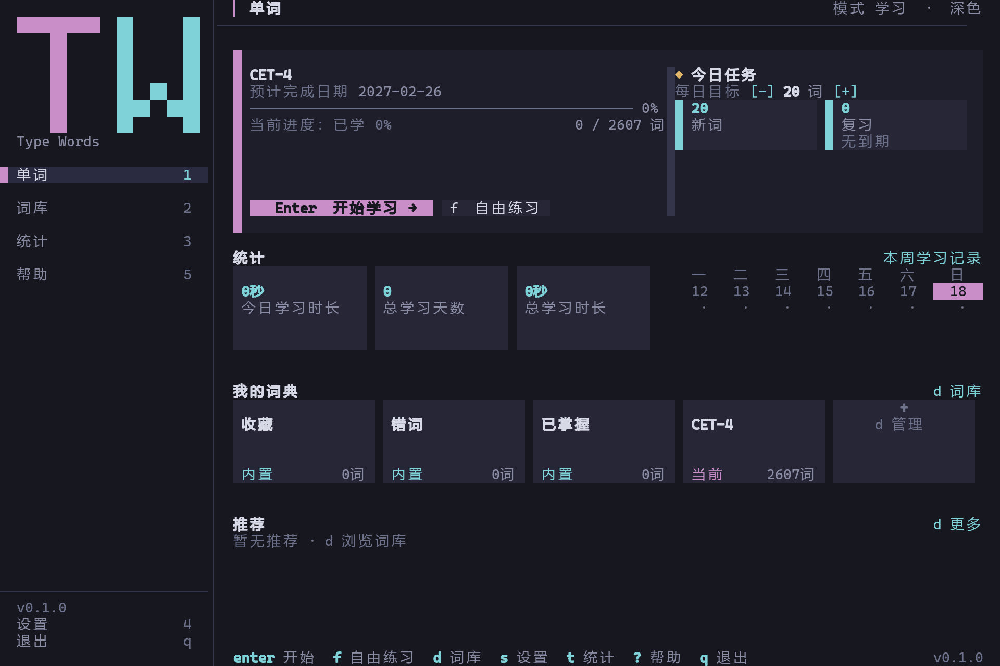
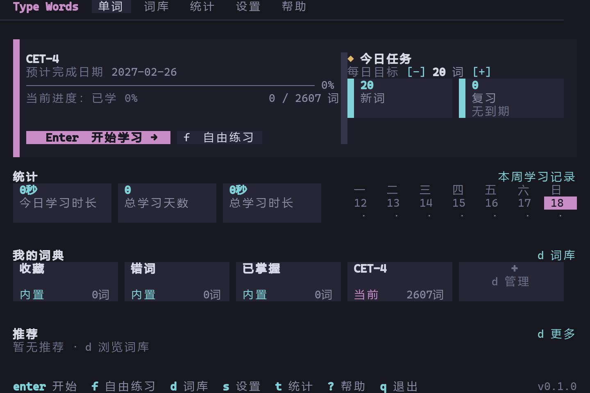
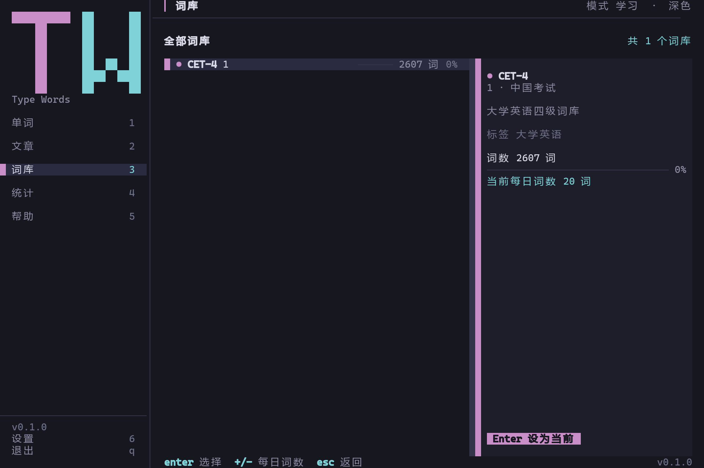
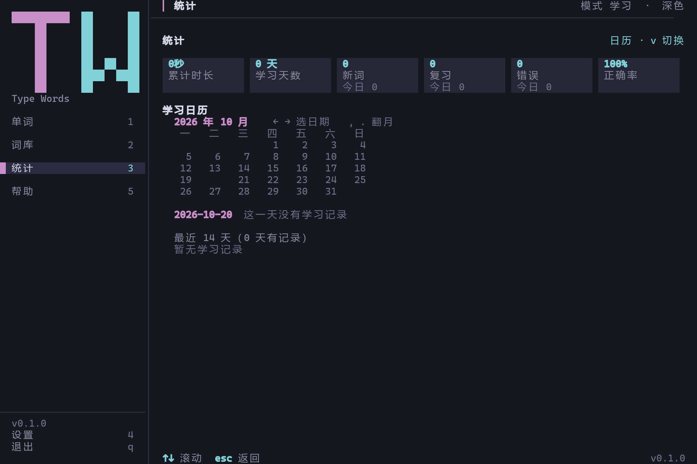
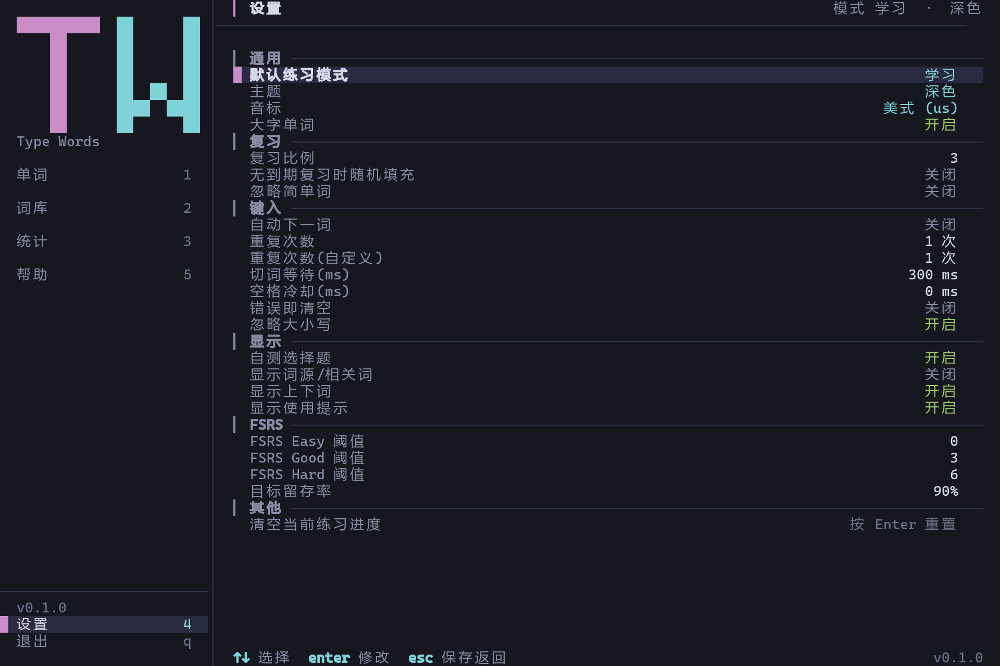
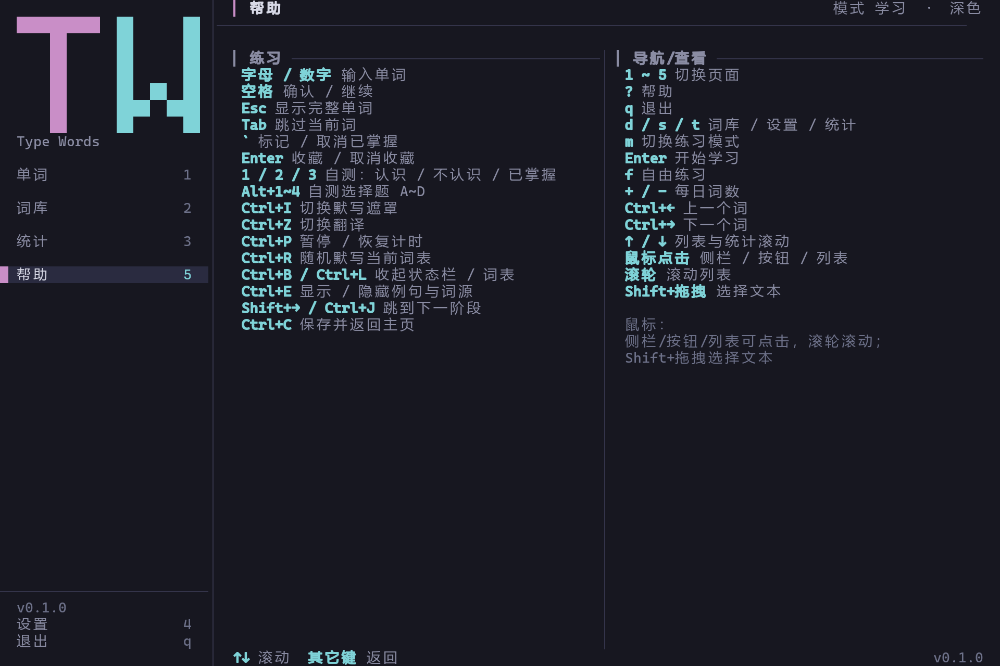
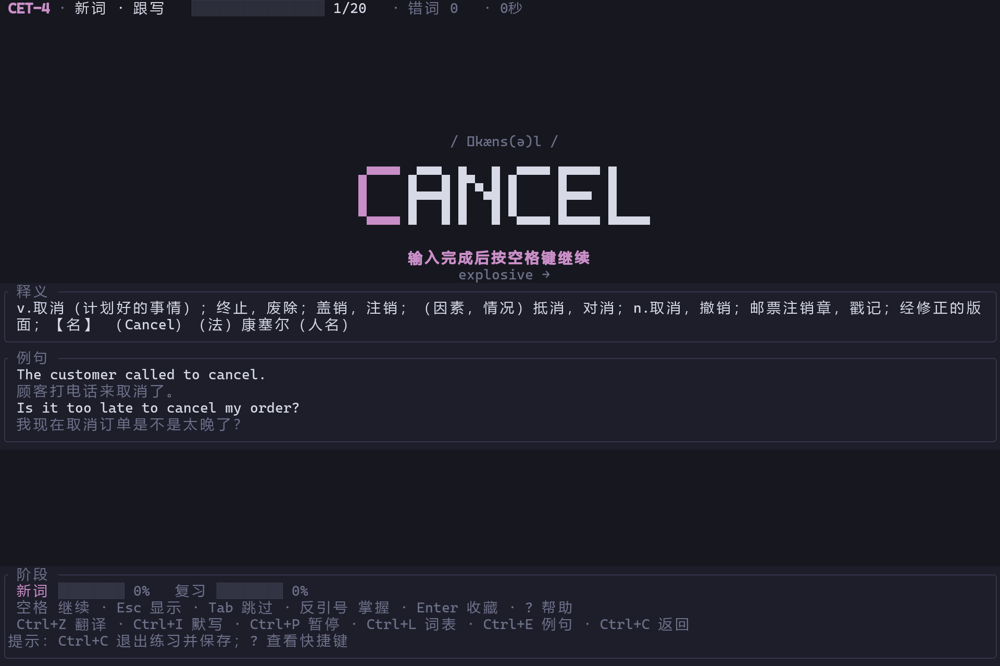
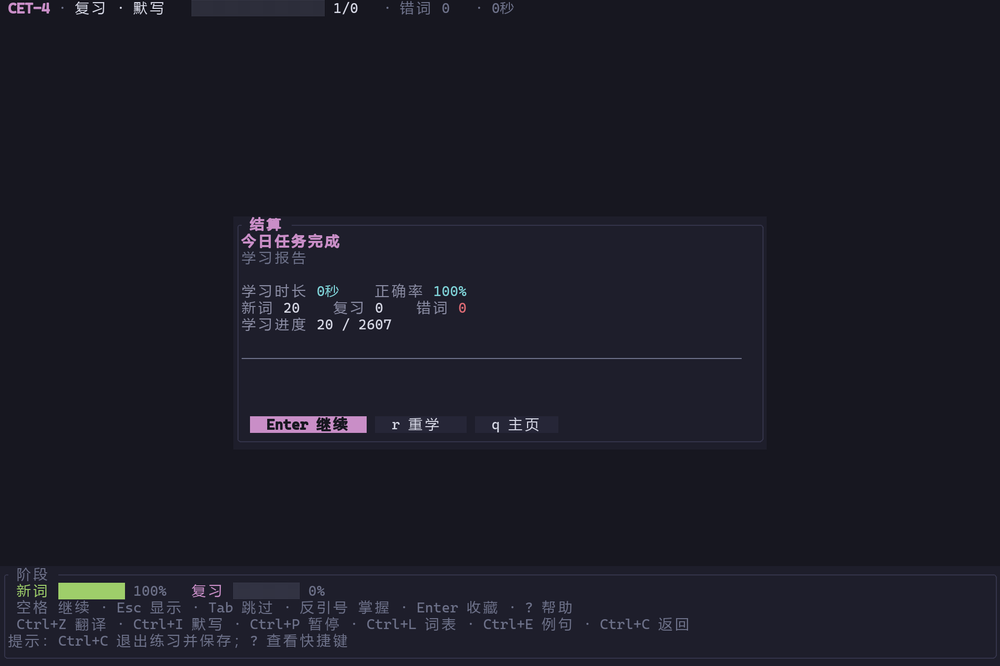
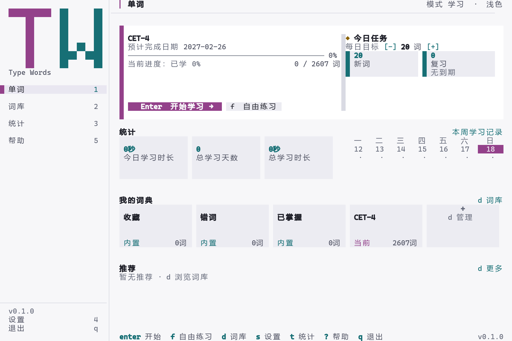
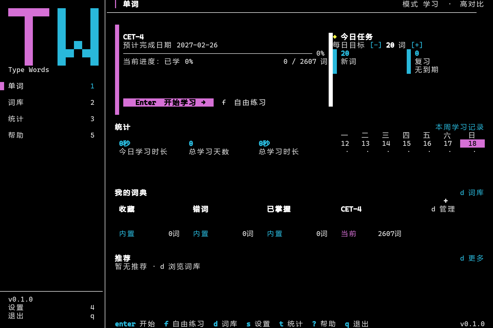

# 使用手册

typewords-tui 是 TypeWords 的终端客户端：在终端里选词库、按 FSRS 排程练习单词、结算并查看统计，进度保存在本地 JSON。本文是面向使用者的完整手册，从安装讲到排障；项目定位与功能全景见 [根 README](../README.md)。

界面和文案为简体中文，操作以键盘为主、鼠标为辅。设置项逐个解释见 [设置项参考](settings.md)，配色与自定义主题见 [主题系统](themes.md)，数据文件格式见 [存档与数据格式](persistence.md)。

> 适用范围：安装、首次使用、命令行、界面、练习流程、按键与鼠标、设置入口、数据备份与排障；对应版本：typewords-tui 0.1.0。

## 这是什么

typewords-tui 把上游 TypeWords（Nuxt + Vue 的 Web / Tauri 桌面端）的「单词练习闭环」搬到终端：选词库 → 按 FSRS 生成今日任务 → 跟写 / 听写 / 默写 / 自测 / 复习 / 随机 / 自由共 7 种流程 → 结算 → 统计。存档是本地 JSON，重启进程可继续上次练习。

适合习惯终端与键盘、希望用 FSRS 安排复习、又不想开浏览器的用户。v1 不包含音频、文章背诵、云同步、在线翻译和自定义快捷键；完整列表与与上游的差距见 [与上游对照](upstream-parity.md)。

## 环境要求与终端兼容性

| 项 | 要求 |
| --- | --- |
| 操作系统 | 发布包为 Windows `x86_64-pc-windows-msvc`；源码可在 Linux / macOS 构建（CI 覆盖 Ubuntu 与 Windows，macOS 未持续验证） |
| 构建工具 | Rust **1.90+** stable（edition 2024）；Windows 装好 MSVC 工具链即可 `cargo build` |
| 运行依赖 | 无 Node.js / WebView / 网络；词库资源随程序目录分发 |
| 终端尺寸 | 最小 **60 × 20**；窗口更小只渲染「终端太小，请放大窗口」 |
| 颜色 | 深色 / 浅色主题按 24-bit RGB 输出，建议支持真彩色（`COLORTERM=truecolor`）；低色彩终端用「高对比」主题 |
| 鼠标 | 需要终端上报鼠标事件；不支持时仍可纯键盘操作 |
| 终端字体 | 需等宽且支持中文与制表符；Windows 推荐 **Windows Terminal**（conhost 对 CJK 宽度与部分组合键支持较差） |

组合键在部分终端或输入法下会被吞掉：常见的是 `Alt+数字`、`Ctrl+方向键`、`Ctrl+Enter`；部分终端还会把 `Ctrl+I` / `Ctrl+J` / `Ctrl+M` 与 Tab / 换行 / Enter 视为同一字节。替代方式见「按键参考」。

程序正常退出会恢复终端；如果进程被强制结束（任务管理器、关闭终端窗口），终端可能停在备用屏幕或鼠标捕获状态，重开一个终端即可。

## 安装

### 下载发布包（推荐）

从 [Releases](https://github.com/StarTurambar/typewords-tui/releases) 下载 `typewords-tui-v0.1.0-x86_64-pc-windows-msvc.zip` 及其 `.sha256` 校验文件，解压后目录结构：

```text
typewords-tui-v0.1.0-x86_64-pc-windows-msvc/
  tw.exe
  assets/
    list/word.json            # 词库目录（内置 CET-4，2607 词）
    dicts/en/word/CET4_T.json # 词条数据
  docs/                       # 本套文档（含截图）
  README.md
  LICENSE
```

在终端里运行 `tw.exe`（或双击）即可启动；程序会自动使用与 `tw.exe` 同级的 `assets/`。包内的 `docs/` 就是本套文档（含截图），可离线查阅。建议先运行 `tw.exe doctor` 确认路径与词库被正确识别。

校验下载包（PowerShell）：

```powershell
Get-FileHash .\typewords-tui-v0.1.0-x86_64-pc-windows-msvc.zip -Algorithm SHA256
Get-Content .\typewords-tui-v0.1.0-x86_64-pc-windows-msvc.zip.sha256
```

两行哈希一致再解压运行；`.sha256` 文件内容为 `<sha256>  <zip 文件名>`。没有校验过的包不要运行。

### 从源码构建

```bash
git clone https://github.com/StarTurambar/typewords-tui.git
cd typewords-tui
cargo run                              # 开发运行，自动使用仓库内 assets/
cargo run -- --home target/tmp/home    # 用临时数据目录调试，不污染真实存档
cargo build --release --locked         # 发布构建，产物 target/release/tw.exe
```

- 仓库自带 `assets/`（内置 CET-4）；直接运行 `target/release/tw.exe` 时需把 `assets/` 放在 exe 同级，或用 `--assets` / `TYPEWORDS_ASSETS` 指定。
- `--locked` 按仓库提交的 `Cargo.lock` 锁定依赖版本。
- 本地打 Windows 包：`pwsh -File scripts/package.ps1`，产物在 `dist/`（含 `assets/`、`docs/`、`README.md`、`LICENSE`，并生成 `.zip.sha256`）；发布流程见 [开发指南](development.md)。

### 首次启动与数据目录

首次运行会自动创建数据目录：

| 系统 | 默认数据目录 |
| --- | --- |
| Windows | `%LOCALAPPDATA%\typewords-tui` |
| Linux | `$XDG_DATA_HOME/typewords-tui`，缺省 `~/.local/share/typewords-tui` |
| macOS | `~/Library/Application Support/typewords-tui` |

目录里会出现 `dict.json`（词典与学习进度、FSRS 卡片、系统词典、统计）、`setting.json`（设置）和 `practice-word.json`（断点缓存，随练习生成）；`themes/`、`dicts/`、`list/` 用于自定义主题与用户导入词库。字段细节见 [存档与数据格式](persistence.md)。

首次启动没有存档时使用默认设置，并自动选择内置词库（优先 `cet4`，否则第一本）。退出程序：回到主页按 `q`（或点侧栏「退出」）并确认；正常退出会保存词典、设置与未结算的练习缓存。

### 升级与版本兼容

升级 = 用新版本替换 `tw.exe` 与 `assets/`，保留数据目录。存档字段向后兼容（缺省字段用默认值填充），但版本策略不同：

| 文件 | 版本 | 遇到更高版本时 |
| --- | --- | --- |
| `dict.json` | 4 | 本次运行只读，不覆盖原文件，提示升级 |
| `setting.json` | 23 | 用默认值启动并提示；本次运行只读，修改不会写回（先备份后升级） |
| `practice-word.json` | 2 | 版本不符时忽略并提示（不移动文件），练习从新会话开始 |

因此升级前建议备份数据目录；降级使用旧版本时也可能触发上述保护。具体格式与迁移说明见 [存档与数据格式](persistence.md)。

## 首次使用（三分钟）

1. **检查环境**：运行 `tw doctor`，确认「数据目录」「资源目录」正确、词库列表有文件路径、没有主题告警。有问题先按输出处理（见「常见问题与排障」）。
2. **启动**：运行 `tw`，进入主页。
3. **选词库**：默认已选内置 CET-4。要换词库按 `d`（或点侧栏「词库」），`↑`/`↓` 选择，`Enter` 设为当前（或点详情里的「Enter 设为当前」）。
4. **开始学习**：主页按 `Enter`（或点「开始学习 / 继续学习」按钮）；想不改变默认模式、只练一轮，按 `f` 自由练习。
5. **按提示输入**：跟写阶段照着大字逐字母输入，完成后按空格确认；听写看音标回忆，默写看释义回忆，自测用 `1`/`2`/`3` 或 `Alt+1`~`Alt+4`。
6. **结算**：本轮流程走完弹出结算；`Enter` 继续下一组，`r` 重学一遍，`q` 回主页。
7. **看统计**：按 `t`（或侧栏「统计」）查看累计概览与最近 14 个有记录的日子；主页也有今日时长与本周记录。

典型操作序列：

```bash
tw doctor      # 1. 检查路径与词库
tw             # 2. 启动界面
# 界面内：Enter 开始 → 输入单词 → Space 确认 → … → 结算 Enter → q 回主页
```

练习过程中会持续写断点缓存，直接关闭程序再打开会恢复到同一词、同一阶段（除非用了 `--reset-practice`）。

## 命令行参考

### 参数

| 参数 | 含义 | 备注 |
| --- | --- | --- |
| `--assets DIR` | 只读资源目录，需含 `list/word.json` | 全局参数，可放在子命令前后；等价环境变量 `TYPEWORDS_ASSETS` |
| `--home DIR` | 数据目录（存档、导入词库、主题） | 全局参数；等价 `TYPEWORDS_HOME` |
| `--dict ID` | 启动时切到指定词库（id 或 enName，如 `cet4`） | 会写入当前学习词库；找不到词库时报错退出 |
| `--mode MODE` | 覆盖练习模式：`system/free/review/shuffle/identify/dictation/listen` | 额外接受 `smart`（= system）与中文别名；退出时随设置保存 |
| `--theme NAME` | 覆盖主题：`dark` / `light` / `high-contrast` / `auto` 或自定义文件名 | 未知名字回退深色并 Toast；退出时随设置保存 |
| `--seed N` | 固定随机种子（复现问题用） | 影响洗牌、选择题与随机复习；日常可省略 |
| `--reset-practice` | 启动前清空练习缓存 | 只清 `practice-word.json`，不动词典与设置；对 `doctor`/`task` 无效 |
| `-h` / `--help`、`-V` / `--version` | 帮助与版本 | 由 clap 生成，`--version` 输出 `tw 0.1.0` |

### 子命令

| 子命令 | 作用 | 输出要点 |
| --- | --- | --- |
| `tw doctor` | 打印解析到的路径与词库状态，不进入界面、不写存档 | 版本行、数据目录、资源目录；每本词库的 id / enName / 名称 / 词数与词条文件路径；`dict.json`/`setting.json`/`practice-word.json` 的字节数或「不存在」；自定义主题数量、主题目录、全部主题 id 与名称、加载告警 |
| `tw task` | 只预览今日任务，不进入界面 | 当前词库、每日词数、学习进度、今日任务（新词 / 复习，到期数、随机补足数）与前 5 个新词、复习词；随机种子默认 42，可用 `--seed` |
| `tw import-dict FILE` | 把词条数组 JSON 复制到 `<home>/dicts/en/word/` 并登记到 `<home>/list/word.json` | 成功后打印词库名、词数与提示 `使用 tw --dict <id> 切换到该词库`；id 取文件名去掉 `.json` |

`import-dict` 的要求：文件必须以 `.json` 结尾、内容为词条数组（每项至少含 `word` 字段）、至少有一个可用单词；id 取文件名去掉 `.json`。重复导入同一文件名会覆盖同 id 的登记项（词条文件也覆盖），不会产生重复条目；细节见 [存档与数据格式](persistence.md)。

### 环境变量与目录查找顺序

| 环境变量 | 作用 | 优先级 |
| --- | --- | --- |
| `TYPEWORDS_HOME` | 数据目录 | 低于 `--home`，高于系统默认目录 |
| `TYPEWORDS_ASSETS` | 资源目录 | 低于 `--assets` |

资源目录按以下顺序查找，取第一个包含 `list/word.json` 的目录：

1. `--assets DIR`
2. `TYPEWORDS_ASSETS`
3. 可执行文件同级的 `assets/`
4. 当前目录及其向上最多 3 级祖先的 `assets/`；同一层级的 `public/` 也接受（兼容从上游仓库内运行）

全部失败时启动报「找不到词库资源目录」。数据目录则按 `--home` > `TYPEWORDS_HOME` > 系统本地数据目录查找，都没有时提示用 `--home` 指定。

词库目录是 `<assets>/list/word.json` 与 `<home>/list/word.json` 的合并结果，同 id 时数据目录（用户导入）覆盖资源目录；词条文件同样先找 `<home>/dicts/…`，再找 `<assets>/dicts/…`。

### 常用示例

```bash
tw --dict cet4                      # 直接进入 CET-4
tw --mode free                      # 以自由练习启动（退出后写回设置）
tw --home D:\tmp\twhome          # 用临时数据目录，不污染真实存档
tw --home D:\tmp\twhome --assets .\assets
tw doctor --home D:\tmp\twhome  # 全局参数也可放在子命令之后
tw task --seed 42                   # 预览今日任务，固定随机种子
tw import-dict .\my-words.json     # 导入自定义词库，再用 tw --dict my-words 切换
tw --seed 42 --reset-practice       # 复现问题时清掉断点缓存
```

## 界面导览

除练习页外，所有页面共用一套外壳；练习页是全屏布局，不显示侧栏 / 顶栏 / 底栏。下面截图默认 120×40 深色主题，个别图注标了尺寸或主题。



### 外壳

| 区域 | 宽屏（≥ 100 列） | 窄屏（< 100 列） |
| --- | --- | --- |
| 导航 | 左侧栏 24 列（≥ 120 列时 26 列）：`TW` 点阵标识、`Type Words`、单词 / 词库 / 统计 / 帮助（带数字键）、分隔线、版本号、设置、退出 | 无侧栏；顶栏左侧 `Type Words`，右侧「单词 / 词库 / 统计 / 设置 / 帮助」点击标签，当前页高亮 |
| 顶栏 | 当前页标题（`▎` 前缀），右侧空间足够时显示「模式 X · 主题名」 | 顶栏左侧 `Type Words`，右侧导航标签（当前页高亮），不显示模式 / 主题 |
| 底栏 | 左侧 Toast（成功 / 警告 / 错误 / 信息分别用不同颜色，约 3.2 秒消失、最多 4 条）；无 Toast 时显示当前页快捷键；右侧版本号 | 同左 |

窗口小于 60 × 20 时只显示「终端太小，请放大窗口 / 最小尺寸 60 × 20」。



### 主页

1. **当前词库卡片**：词库名、预计完成日期（已学完显示「已学完 · 总复习阶段」）、进度条与百分比、「已学 N / M 词」；底部按钮「Enter 开始 / 继续学习」与「f 自由练习」。
2. **今日任务**（卡片右侧）：每日目标 `[-] N [+]`（每次 ±5 词）与「新词 / 复习」数字卡；无到期复习时显示「无到期」。
3. **统计**：今日学习时长 / 总学习天数 / 总学习时长；右侧「本周学习记录」按周一至周日，今天高亮，有记录显示 `●`，否则 `·`。
4. **我的词典**：3~5 块词库卡（`内置` / `当前` / `词库` 徽标 + 词数），不够时补「+ d 管理」；标题右侧「d 词库」可点。
5. **推荐**：未加入的词库（名称 / 简介 / 词数），标题右侧「d 更多」；没有推荐时显示「暂无推荐 · d 浏览词库」。

窗口高度不足时依次收起「推荐」「我的词典」；宽度不足时隐藏「本周学习记录」。

### 词库页

左侧是全部词库列表（当前词库 `●`、光标 `▶`、进度条、词数、百分比，溢出时右侧显示 `↑` / `↓`），右侧是选中词库的详情（名称、id、分类、简介、标签、词数、进度、每日词数）与「Enter 设为当前」按钮。内容宽度不足 72 列时只显示列表。



### 统计页

6 块总览卡：累计时长、学习天数、新词、复习、错误、正确率，其中新词 / 复习 / 错误带今日增量；下方「最近 14 天」列出**最近 14 个有记录的自然日**（不是固定 14 天窗口），每行是日期、用时条、用时与新 / 复 / 错计数；记录多于一屏时可滚动，底部给出「向上滚动 / 继续滚动 / 已到底部」提示。



### 设置页

单列表格，按「通用 / 复习 / 键入 / 显示 / FSRS / 其他」分区，每行「名称 + 当前值」；上下溢出时右侧显示 `↑` / `↓`。操作与含义见「设置」与 [设置项参考](settings.md)。



### 帮助页

宽屏分「练习」「导航/查看」两栏，窄屏单栏并滚动（右侧 `↑` / `↓`）；末尾是鼠标操作说明。滚动键以外任意键返回上一层（练习中进入则回练习）。



### 练习页

全屏布局，从上到下：

- **状态行**：词库 · 阶段（如「新词 · 跟写」「小组巩固」「错词巩固」）· 进度条 · 当前序号 / 总数 · 错词数（有错词时用警示色）· 计时（暂停时显示「已暂停」）。
- **单词区**：音标 → 大字单词（5×7 点阵，空间足够时 2 倍像素）→ 输入提示 → 相邻词（可关闭）。已输入正确的字母为成功色、错误为错误色、下一个待输入字母为强调色；遮罩 / 默写模式下未输入字母显示空心方框，不泄露字形。超长单词压缩字距或拆行，点阵不支持的字符回退普通文本。
- **信息卡片**：释义、例句（以及开启后的词源 / 词根），按宽度折行，超出高度以「…」截断。
- **底部阶段条**：每个节点一根进度条、两行快捷键与临时提示；`Ctrl+B` 收起。
- **词表侧栏**：`Ctrl+L` 展开，每行序号 + 单词，`▶` 当前词、错词用错误色、已排除词用暗色。



### 弹层

| 弹层 | 打开时机 | 内容 |
| --- | --- | --- |
| 结算 | 一轮流程完成 | 学习时长、正确率、新词 / 复习 / 错词、学习进度与进度条；三个按钮「Enter 继续」「r 重学」「q 主页」 |
| 输入 | 设置页修改数字项 | 标题「修改 X（Enter 保存 · Esc 取消）」与当前输入 |
| 确认 | 退出程序、清空练习进度 | 提示文案与「确认 / 取消」按钮 |



## 练习流程

### 七种模式

| 模式 | 词源 | 内置流程（节点 → 步骤） | 适合 |
| --- | --- | --- | --- |
| 学习 `system` | 今日任务：新词 + 到期复习 | 新词：跟写（7 词小组 + 组内拼写）→ 听写 → 默写；复习：自测 → 听写 → 默写 | 日常主流程 |
| 自由练习 `free` | 今日任务：新词 + 到期复习 | 跟写（逐词推进，无小组循环） | 不改默认模式的一次性练习（`f`） |
| 复习 `review` | 今日任务的复习词 | 自测 → 听写 → 默写 | 只处理到期复习 |
| 随机复习 `shuffle` | 已学范围随机抽取（还没学词时取全词库） | 默写 | 打乱巩固已学词 |
| 自测 `identify` | 今日任务：新词 + 复习 | 自测 | 快速判断认识程度 |
| 默写 `dictation` | 今日任务：新词 + 复习 | 默写 | 看释义回忆拼写 |
| 听写 `listen` | 今日任务：新词 + 复习 | 听写（无音频，靠音标与释义回忆） | 看音标回忆拼写 |

- 默认练习模式在设置页「通用」分区或主页按 `m` 切换，循环顺序：学习 → 自由练习 → 复习 → 随机复习 → 自测 → 默写 → 听写。
- 随机复习模式抽取数量为「每日词数 × max(复习比例, 1)」；自由练习与复习都使用同一份今日任务，不会额外取新词。

### 阶段与 7 词小组

```text
学习模式
  新词节点：跟写（每 7 词一组）→ 组内拼写巩固 → 下一组 … → 听写 → 默写
  复习节点：自测 → 听写 → 默写
```

- 「跟写」按 7 词一组推进：整组跟写完后，同一组 7 词立即以「拼写」形式再练一遍（此时单词被遮挡、只显示释义），然后进入下一组；不足 7 词的尾组自成一组。组内拼写阶段的状态显示为「小组巩固」。
- 其余步骤逐词推进；听写、默写步骤进入时会洗牌。
- 底部阶段条按节点显示进度；练习页状态行显示当前「节点 · 步骤」。
- 前进 / 回退：`Ctrl+→`（别名 `Ctrl+N`）下一个词、`Ctrl+←` 上一个词、`Shift+→`（别名 `Ctrl+J`）跳过当前阶段剩余词。

### 错词巩固

任何阶段结束仍有错词时，不进入下一阶段，而是自动进入「错词巩固」：把本阶段错词重新练一遍，固定使用「跟写 + 7 词小组 + 组内拼写」，直到错词清空；期间可能反复循环，并提示「还有错词，继续巩固一下吧」。

- 错词会自动收录进系统词典「错词」，不计入每日词数。
- 自测回答「我认识」、选对答案或按「已掌握」会把该词从错词本移除。
- 错词巩固不计入本轮任务词数，只影响练习过程与最终错词统计。

### 自测

- 题面：单词被遮挡，卡片给出中文释义选项（A~D，词库很小或释义重复时可能少于 4 个）；`Alt+1`~`Alt+4` 选择，也可以直接拼写整个单词（提示「请选择 或 直接拼写」）。
- `1` 我认识：显示单词，按「Good」记录；`2` 不认识：计一次错误；`3` 已掌握：加入已掌握词典并自动进下一词。
- 选择或回答后按空格继续；选项揭晓时按对错着色。注意在自测中直接拼写会先揭晓答案并计一次错误，急着过词时优先用 `1`/`2`/`3` 或选择题。
- 关闭设置「自测选择题」后不显示 A~D，只保留 `1`/`2`/`3` 与直接拼写。

### 结算页

一轮流程完成弹出结算：

- `Enter` / 空格：继续下一组——所结束的会话是随机复习时重新抽词，否则按当前默认练习模式生成今日任务；没有可练的词时提示「没有可学习的单词！」并回主页。
- `r`：重学一遍——回退本轮新词的学习进度、保留收藏与错词，重练本轮词表。
- `q` / `Esc`：回主页。

结算后本轮统计与 FSRS 卡片已写入 `dict.json`，断点缓存被删除。正确率按「(总词数 − 错词词数) / 总词数」计算，错词按本轮出错的不同单词数统计。

### 断点续练

- 练习中每次推进后约 500ms 防抖保存，每累计 30 秒学习时间再保存一次，`Ctrl+C`、退出程序或切回主页时立即保存。
- 重启后若缓存存在且词库、流程、词表都匹配，会直接回到练习页的同一词、同一阶段，并提示「已恢复上次练习进度」。
- 恢复失败会丢弃缓存并从新会话开始：换过词库、词已不在当前词库、游标与流程不匹配时静默；缓存版本不是 2 时启动会弹告警后丢弃。
- `--reset-practice` 或设置页「清空当前练习进度」只清断点缓存；学习进度、统计、FSRS 卡片不受影响。
- 计时在 3 分钟无操作后自动暂停，按 `Ctrl+P` 恢复；暂停期间不计学习时长。

### 每日词数、跳过、收藏、已掌握与错词

| 操作 | 入口 | 行为与落盘 |
| --- | --- | --- |
| 每日词数 | 主页 / 词库页 `+` / `-`（每次 ±5） | 写入 `dict.json` 的每日词数，范围 1 ~ 词库总词数；决定每日新词数与复习上限 |
| 跳过当前词 | `Tab` | 加入本轮排除列表，不计输入数、不算错；下一轮会重新出现 |
| 收藏 | `Enter` | 收藏 / 取消收藏到系统词典「收藏」；随词典保存（`Ctrl+Enter` 可立即保存） |
| 已掌握 | 反引号键 | 在「已掌握」词典中增删；本轮立即排除并进入下一词；已掌握词不再出现在今日任务 |
| 错词 | 输入错误 / 不认识 / 显示答案等 | 自动收录「错词」词典；状态行显示本轮错词数；阶段末触发错词巩固 |
| 显隐 | `Ctrl+Z` 翻译、`Ctrl+I` 默写遮罩、`Ctrl+E` 例句与词源、`Ctrl+L` 词表、`Ctrl+B` 阶段条 | 只对当前词 / 当前阶段有效，切换单词或阶段恢复阶段默认 |

### FSRS 对复习的影响（用户视角）

- 结算时按本轮每个词的错误次数给出评级：默认 0 次为 Easy、1~3 次 Good、4~6 次 Hard、7 次及以上 Again（阈值可在设置页 FSRS 分区调整）。自测回答「认识」或选对答案的词强制记为 Good。
- 评级决定卡片的下次到期：新词评 Easy 直接毕业（FSRS 间隔，至少 1 天）；新词评 Good → 10 分钟、Hard → 6 分钟、Again → 1 分钟的学习步进；处于学习/重学中的词评 Easy/Good 毕业进入复习，评 Hard → 6 分钟、Again → 1 分钟；复习卡评 Hard/Good/Easy 走 FSRS 间隔（至少 1 天），评 Again 进入重学（10 分钟后到期）。
- 复习按本地自然日判断到期（due ≤ 今天即到期），按到期时间从早到晚取「每日词数 × 复习比例」个；没有到期复习且未开启随机填充时，主页显示「无到期」，今日任务只有新词。
- 「目标留存率」影响间隔计算，默认 90%；间隔上限由 FSRS 参数的最大间隔控制（默认 36500 天）。
- 评级映射与 Web 一致，但学习步进固定为 1 / 6 / 10 分钟、间隔由 `fsrs` crate（FSRS-6）计算，具体天数可能与 Web 不同。算法细节见 [领域逻辑](domain.md)，与上游差异见 [与上游对照](upstream-parity.md)。

## 按键参考

### 练习页按键

| 键 | 动作 | 说明 |
| --- | --- | --- |
| 字母 / 数字 / 符号 / 空格 / 退格 | 输入单词 | 带 `Ctrl` / `Alt` 的组合键不进输入 |
| 空格 | 确认 / 继续 | 输入完成后按空格推进；默写 / 听写先揭晓再按一次继续 |
| `Esc` | 显示完整单词 | 遮罩状态或非跟写阶段计一次错误（同一词同一阶段只计一次） |
| `Tab` | 跳过当前词 | 不计输入数、不算错，本轮不再出现 |
| `Enter` | 收藏 / 取消收藏 | 写入「收藏」词典 |
| `Ctrl+Enter` | 立即保存练习进度与词典 | 等价于一次主动落盘 |
| 反引号键 | 标记 / 取消「已掌握」 | 标记后自动进入下一词 |
| `1` / `2` / `3` | 自测：我认识 / 不认识 / 已掌握 | 仅自测阶段生效 |
| `Alt+1`~`Alt+4` | 自测选择题 A~D | 仅自测阶段生效 |
| `Ctrl+Z` | 切换翻译显示 | 当前词有效 |
| `Ctrl+I` | 切换默写遮罩 | 当前词有效 |
| `Ctrl+P` | 暂停 / 恢复计时 | 暂停时状态行显示「已暂停」 |
| `Ctrl+R` | 随机默写当前词表 | 打乱本轮词表并遮挡，从头开始 |
| `Ctrl+B` | 显示 / 隐藏底部阶段条 | 隐藏后底栏只留一行提示 |
| `Ctrl+L` | 显示 / 隐藏右侧词表 | 显示当前词、错词与已排除词 |
| `Ctrl+E` | 显示 / 隐藏例句与词源 | 总开关；词源还需设置项开启 |
| `Ctrl+C` | 保存并返回主页 | 不是退出程序 |
| `Ctrl+→`（别名 `Ctrl+N`） | 下一个词 | 组合键被吞时用别名 |
| `Ctrl+←` | 上一个词 | 已是第一个时提示 |
| `Shift+→`（别名 `Ctrl+J`） | 跳到下一阶段 | 跳过当前阶段剩余词 |
| `?` | 帮助 | 帮助页按非滚动键返回练习 |

### 其它页面按键

| 页面 | 键 | 动作 |
| --- | --- | --- |
| 主页 | `Enter` | 开始 / 继续学习 |
| 主页 | `f` / `d` / `s` / `t` | 自由练习 / 词库 / 设置 / 统计 |
| 主页 | `m` | 切换默认练习模式 |
| 主页 | `+` / `-` | 每日词数 ±5 |
| 主页 | `1`~`5` | 单词 / 词库 / 统计 / 设置 / 帮助 |
| 主页 | `?` / `q` | 帮助 / 退出（弹确认） |
| 词库页 | `↑` / `↓`（别名 `j` / `k`） | 选择词库 |
| 词库页 | `Enter` | 设为当前词库并回主页 |
| 词库页 | `+` / `-`、`Esc` / `q` | 调整当前学习词库的每日词数 / 返回 |
| 统计页 | `↑` / `↓`（`j` / `k`）、`PgUp` / `PgDn` | 滚动 / 翻 5 行 |
| 统计页 | `Esc` / `q` / `Enter` | 返回 |
| 设置页 | `↑` / `↓`（`j` / `k`） | 选择设置项 |
| 设置页 | `Enter` / 空格 | 修改当前项 |
| 设置页 | `Esc` / `q` | 保存并返回 |
| 帮助页 | `↑` / `↓`（`j` / `k`）、`PgUp` / `PgDn`、滚轮 | 滚动 |
| 帮助页 | 其它任意键 | 返回上一层 |

### 弹层按键

| 弹层 | 键 | 鼠标 |
| --- | --- | --- |
| 确认 | `Enter` / `y` / `Y` 确认；其它任意键取消 | 点「确认 / 取消」按钮；点击弹层外区域取消 |
| 输入 | 数字、`Backspace`、`Enter` 保存、`Esc` 取消 | 点击弹层外取消；内部点击无动作 |
| 结算 | `Enter` / 空格继续、`r` 重学、`q` / `Esc` 回主页 | 只响应三个按钮 |

### 按键优先级与注意事项

1. **弹层优先**：有结算 / 输入 / 确认弹层时，除该弹层支持的键外其它按键不生效。
2. **练习页优先于页面键位**：进入练习后 `1`~`5`、`s`、`t` 等不再是快捷键，而是输入字符；`1`/`2`/`3` 只在自测阶段被解释为选项。
3. **数字切页**：`1`~`5` 仅在非练习、无弹层、且不在帮助页时切页；帮助页的「其它键返回」优先于数字切页。
4. **帮助页返回**：练习中进入帮助后，返回的是练习页；其它页面进入则回主页。
5. **`Esc` 不退出练习**：它只显示完整单词；退出程序要先回主页按 `q`。
6. **组合键被吞**：`Alt+数字`、`Ctrl+方向键`、`Ctrl+Enter` 在部分终端 / 输入法下无事件；可用 `Ctrl+N`（下一词）、`Ctrl+J`（下一阶段）、直接拼写（代替选择题）；自动保存与退出保存可替代 `Ctrl+Enter`。
7. **全角标点**：输入会按目标字符归一化（如「？」可当 `?`、全角引号可当半角），默写阶段对引号等也做同样处理；大小写按「忽略大小写」设置。

## 鼠标操作

启动时程序会开启终端鼠标捕获。支持范围：

- **导航**：宽屏侧栏的「单词 / 词库 / 统计 / 帮助 / 设置 / 退出」，窄屏顶栏的页面标签。
- **按钮**：主页「开始 / 继续学习」「f 自由练习」、每日目标 `[-]` / `[+]`；词库页「Enter 设为当前」；确认 / 结算弹层的按钮。
- **区块入口**：主页「我的词典」标题右侧的「d 词库」、「推荐」标题右侧的「d 更多」。
- **列表**：词库页与设置页的行。**第一次点击选中该行，再次点击已选中的行才激活**（词库页：设为当前词库并回主页；设置页：修改该项）；也可以选中后按 `Enter`。
- **滚轮**：词库页 / 设置页移动光标，统计页滚动最近记录，帮助页滚动快捷键列表；练习页与主页忽略滚轮。
- **弹层**：确认弹层点击按钮生效、点击弹层外取消；输入弹层点击弹层外取消（内部点击无动作，用 `Enter` / `Esc`）；结算弹层只响应三个按钮。
- **帮助页**：点击内容区任意位置返回上一层。

注意：

- 终端会把鼠标事件交给程序，因此终端原生的拖拽选择 / 右键菜单会失效；**按住 `Shift` 拖拽**可选择文本（多数终端如此，个别终端用 `Alt` 或需在终端设置里关闭鼠标上报）。
- 终端是否上报鼠标事件由终端决定；不支持或关闭了鼠标上报时点击不会有反应，此时仍可纯键盘操作，不是程序故障。
- 练习页本身没有点击目标（当前词 / 输入只能用键盘），鼠标只在结算弹层里点按钮。

## 设置

- **进入**：主页按 `s` 或 `4`，或点击侧栏「设置」。练习中不能进入设置页，先回主页。
- **选择与修改**：`↑` / `↓`（别名 `j` / `k`）移动；`Enter` 或空格修改——开关类直接切换，模式 / 主题 / 音标循环切换，数字类弹出输入框（只接受数字与 `Backspace`，最多 6 位，`Enter` 保存、`Esc` 取消，留空按 0 处理再按范围收敛），「清空当前练习进度」弹确认。
- **保存时机**：每次修改立即写入 `setting.json`；`Esc` / `q` 返回主页时再保存一次。
- **没有「恢复默认」入口**：要恢复默认值需删除或手工修改 `setting.json`（见 [存档与数据格式](persistence.md)）。
- 设置页共 23 行（22 个配置项 + 1 个动作项），按「通用 / 复习 / 键入 / 显示 / FSRS / 其他」分区；每项的配置键、默认值、取值范围、生效方式，以及无 UI 的透传字段，见 [设置项参考](settings.md)。

## 主题

- **内置主题**：`dark` 深色（默认，`auto` 等同深色）、`light` 浅色、`high-contrast` 高对比（纯 ANSI 颜色，适合低色彩终端）。

| 深色 | 浅色 | 高对比 |
| --- | --- | --- |
|  |  |  |

- **切换**：设置页「主题」一行循环 `auto` → 内置主题 → 自定义主题（按文件名排序）；启动参数 `--theme NAME` 可覆盖（退出时随设置保存，未知名字回退深色并 Toast）。
- **自定义主题**：把 `*.json` 放进 `<home>/themes/`，启动时加载，新增或修改后需重启进程；文件校验失败只跳过该文件并告警，`tw doctor` 可查看主题清单与告警。
- 颜色 token、文件格式、校验规则与排错见 [主题系统](themes.md)。

## 数据与备份

| 路径 | 内容 |
| --- | --- |
| `<home>/dict.json` | 词典元数据与词表、学习进度、FSRS 卡片、收藏 / 错词 / 已掌握、统计 |
| `<home>/setting.json` | 设置项（与主题选择） |
| `<home>/practice-word.json` | 断点练习缓存（单词、游标、统计快照） |
| `<home>/themes/*.json` | 自定义主题 |
| `<home>/dicts/en/word/*.json` | `import-dict` 导入的词条文件 |
| `<home>/list/word.json` | 用户词库目录（与内置目录合并） |

- **备份**：退出程序后复制整个数据目录即可（三份 JSON + 主题 + 导入词库）。
- **恢复 / 迁移**：把备份目录放回原路径，或用 `--home` / `TYPEWORDS_HOME` 指向备份目录；换机器同理。
- **重置**：删除 `practice-word.json` 只清断点缓存；删除 `setting.json` 恢复默认设置；删除 `dict.json` 会丢失学习进度、统计、FSRS 卡片与三本系统词典（谨慎）。`--reset-practice` 等价于只清断点缓存。
- **损坏与版本**：存档损坏会被重命名为 `*.corrupt-<时间戳>.json` 并回退默认值；版本过高的 `dict.json` / `setting.json` 本次运行只读、不覆盖原文件；练习缓存版本不符会被忽略。恢复细节见 [存档与数据格式](persistence.md)。

## 常见问题与排障

### 排障表

| 现象 | 可能原因 | 处理 |
| --- | --- | --- |
| 启动报「找不到词库资源目录」 | `assets/` 不在 exe 同级或当前目录，`--assets` 指向的目录没有 `list/word.json` | 把 `assets/` 放到 `tw.exe` 同级，或用 `--assets` 指向包含 `list/word.json` 的目录 |
| 启动报「加载词库失败」 | 存档里的当前词库在资源目录中找不到，或词条文件缺失 | `tw doctor` 看每本词库的「文件」路径；用 `--dict` 指定存在的词库 |
| 启动无反应 / 一直黑屏 | 终端小于 60 × 20 只显示提示；或进程还在装载大词库 | 放大窗口；等待首帧；按 `Ctrl+C` 退出后重试 |
| 退出后终端显示错乱 | 进程被强制结束，未恢复备用屏幕 / 鼠标捕获 | 重开终端；Unix 可执行 `reset` |
| 中文、边框错位 | 终端字体非等宽或不支持 CJK / 制表符；使用 conhost | 换 Windows Terminal，设置等宽且支持中文的字体 |
| 颜色发灰、偏色 | 终端不支持 24-bit 真彩色 | 确认 `COLORTERM=truecolor`；或换「高对比」主题 / 自定义 ANSI 颜色主题 |
| 鼠标点击没反应 | 终端不支持鼠标上报，或点击位置不是可点目标 | 用键盘；练习页本身无点击目标 |
| 无法复制文本 / 右键菜单失效 | 程序开启了鼠标捕获 | 按住 `Shift` 拖拽选择文本（个别终端用 `Alt` 或关闭鼠标上报） |
| 组合键无效（`Alt+数字`、`Ctrl+方向键`、`Ctrl+Enter`） | 终端或输入法拦截了组合键 | 用 `Ctrl+N` / `Ctrl+J` 别名、自测直接拼写；保存依赖自动保存或退出保存 |
| 中文输入法把字母变成汉字 | 输入法未切到英文 | 切到英文输入；程序按字符接收按键 |
| 提示「存档已损坏，已隔离」 | 存档 JSON 损坏 | 坏文件已改名 `*.corrupt-<时间戳>.json`，可删除或用于排查；程序已回退默认值 |
| 提示「存档版本过高」 | 存档来自更新版本的程序 | 升级程序；`dict.json` 与 `setting.json` 本次都只读、不会被覆盖，本次修改不会写回，先备份再升级 |
| 提示「没有可学习的单词！」 | 没有新词且没有到期复习（全部学完或标记已掌握） | 换词库、取消已掌握标记、开启「无到期复习时随机填充」，或用随机复习 / 自由练习 |
| 自定义主题没生效 / 启动有主题告警 | 主题文件名、JSON 字段、颜色写法或保留名不合规 | `tw doctor` 查看主题 id 与告警；修改后需重启进程 |
| 听写没有声音 | TUI 无音频（设计如此） | 听写依靠音标与释义回忆；需要发音请用 Web 版 |
| 某项设置改了没效果 | 该项只保存不生效，或生效时机未到 | 查 [设置项参考](settings.md) 的「未生效 / 半生效」清单与生效时机 |
| 每日词数调不动 | 已到 1 ~ 词库总词数的边界，或当前词库未加载 | 词库页先「设为当前」；范围受词库词数限制 |
| 练习进度没保存 | 进程被强杀，防抖保存尚未落盘 | 正常退出或按 `Ctrl+Enter`；重启后最多丢失约 0.5 秒内的推进 |
| 存档在哪 / 能否多设备同步 | 数据在本地数据目录；v1 无云同步与账号 | 见「数据与备份」；多设备只能手工复制数据目录 |

### FAQ

- **和 Web 版 TypeWords 是什么关系？** 独立的终端客户端：共享词库资源格式与存档字段命名，不共享代码，也不读写浏览器 IndexedDB；功能差异见 [与上游对照](upstream-parity.md)。
- **会联网吗？** 不会。无网络请求、无遥测、无账号，数据全部在本地。
- **能改快捷键吗？** v1 键位固定，帮助页（`?`）可随时查看。
- **支持 Linux / macOS 吗？** 源码跨平台（CI 覆盖 Ubuntu 与 Windows），发布包只有 Windows；其他平台可从源码构建，并自备 `assets/`。
- **为什么听写没有发音？** 终端版不引入音频依赖；听写以音标 + 释义替代发音提示。
- **如何报告问题？** 带上版本、`tw doctor` 输出与复现步骤，见「反馈与贡献」。

## 反馈与贡献

- **提 issue** 建议附：`tw --version` 输出、`tw doctor` 输出、操作系统与终端（如 Windows Terminal 1.x）、复现步骤、是否使用 `--home` / `--assets` / `--seed`，以及相关 Toast 文案。涉及随机行为时附上 `--seed` 值。
- **参与开发**：构建、测试、截图与发布流程见 [开发指南](development.md)；分层与模块职责见 [总体架构](architecture.md)；文档约定见 [文档索引](README.md)。
- **功能差距与路线图**：[与上游对照](upstream-parity.md)。
- **许可证**：GPL-3.0；词库数据来自上游 TypeWords 仓库，遵循同一许可证，再分发时保留 `LICENSE`。

## 相关文档

- [文档索引](README.md)
- [设置项参考](settings.md)
- [主题系统](themes.md)
- [存档与数据格式](persistence.md)
- [与上游对照](upstream-parity.md)
